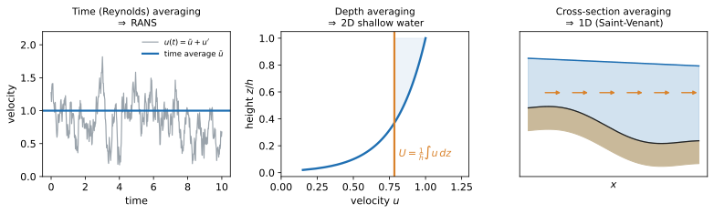

# Components of a Model and Governing Equations

## The big picture

A model replaces a continuous physical domain governed by PDEs with a discrete domain and a system of algebraic equations, which is then solved on a computer.

- Continuous equations contain terms such as $u\,\partial u/\partial x$ and $\partial u/\partial t$.
- These derivatives are approximated with algebraic expressions on a discrete grid.

**Motivating example:** salt concentration in a river reaching the sea (e.g., the Fraser River estuary). Where do we want the concentration (a point in space, a vertical profile)? What dynamics control it? Which equations express those dynamics mathematically?

## What do we need to model something?

1. **Quantities and domain of interest.** Velocity (1D, 2D, 3D?), salt concentration, dissolved oxygen, temperature; at what location, and as a function of time? Is the problem time dependent? Can we get away with 1D or 2D? How important are the processes in the neglected dimensions? Is the geometry complex?
2. **Governing equations.** The question determines the equation set:
   - Flood depth at a downstream city from storms in a large basin: 1D analysis.
   - Depth-averaged velocity around a pioneering island in a restoration project: 2D.
   - Turbulent kinetic energy around an engineered log jam: 3D.
   - Eddy structure around a log jam: 3D, resolving turbulence.
3. **Dimensionality in space and time.** Steps 1, 2, 3 and 4 are connected. Examples: 1D cross-section-averaged flow, 2D depth-averaged ("shallow water") flow, and a vertical profile $u=u(z)$, which is also 1D but a different type of model ("reduced RANS").
4. **Resolution in space and time.** Do the flow features of interest have scales of mm, cm, m or km? Seconds, hours, days, years, 10,000 years? Do time-varying eddies matter?
5. **Numerical approach.** Finite difference (FD) and finite volume (FV) are the most common for fluids. Finite element (FE) is used for fluids but is more common in solids.
6. **Discretization.** Replace the continuous $f(x)$ by values at discrete points spaced $\Delta x$ apart, e.g.

   $$\frac{df}{dx}\;\rightarrow\;\frac{\Delta f}{\Delta x}=\frac{f_2-f_1}{x_2-x_1}.$$

   This is one type of discretization. We also need a *scheme* that represents the governing equation on the discretized domain.
7. **Initial and boundary conditions.** Solutions of both continuous and discrete equations need initial conditions (IC) and/or boundary conditions (BC), depending on (1) the form of the equation and (2) the physical domain. Example: a 1D channel between $x_1$ and $x_2$ with $h=h(x,t)$, an inflow hydrograph $Q(t)$ as the upstream BC, a depth BC downstream, and an IC at $t=0$.
8. **Method of solution.** Write your own code or use a ready-made solver written by someone else. Particular methods follow from the equations and the discretization.
9. **Test the model.** A solver that runs is not necessarily physically meaningful. Ways to test:
   1. Compare a simple case with an analytic solution.
   2. Compare to laboratory data.
   3. Compare to field data.
   4. Compare to other model output.
10. **Run, analyze, extract information.** Once satisfied, run for the conditions of interest and use the model. Always apply the reasonableness test.

## Governing equations

Key physical laws:

1. Conservation of mass
2. Conservation of momentum ($\vec F = m\vec a$, Newton's second law)
3. Conservation of energy

### Conservation of mass

For a fixed mass, $DM_{sys}/Dt=0$. Applying the Reynolds transport theorem:

$$\frac{\partial}{\partial t}\int_{CV}\rho\,dV+\int_{CS}\rho(\vec u\cdot\vec n)\,dA=0,$$

the rate of change of mass in the control volume plus the net mass flux through the control surface. Equivalently, $dM/dt=\sum\dot m_{in}-\sum\dot m_{out}$. The same form holds for a concentration $C\ [M/L^3]$ in place of $\rho$.

Applied at a point, the **full form** is

$$\frac{D\rho}{Dt}+\rho\,\frac{\partial u_i}{\partial x_i}=0\quad\text{or}\quad \frac{D\rho}{Dt}+\rho\left(\frac{\partial u}{\partial x}+\frac{\partial v}{\partial y}+\frac{\partial w}{\partial z}\right)=0.$$

For incompressible flow (water) $D\rho/Dt=0$, so

$$\frac{\partial u}{\partial x}+\frac{\partial v}{\partial y}+\frac{\partial w}{\partial z}=0,$$

i.e., the divergence at a point is zero.

**Averaged forms.** Averaging produces a family of models:

| Averaging | Definition | Continuity equation |
|---|---|---|
| Time averaged | $\bar u=\frac1T\int_t^{t+T}u\,dt$ | $\dfrac{\partial\bar u}{\partial x}+\dfrac{\partial\bar v}{\partial y}+\dfrac{\partial\bar w}{\partial z}=0$ |
| Depth averaged (2D hydraulics) | $\tilde u=\frac1h\int_{z_b}^{z_s}\bar u\,dz$ | $\dfrac{\partial h}{\partial t}+\dfrac{\partial(h\tilde u)}{\partial x}+\dfrac{\partial(h\tilde v)}{\partial y}=0$ |
| Cross-section averaged (1D hydraulics) | $U_{avg}=\frac1A\int_A\bar u\,dA$ | $\dfrac{\partial A}{\partial t}+\dfrac{\partial Q}{\partial x}=0$ (no lateral inflow), $Q=U_{avg}A$ |

Here $h=z_s-z_b$ is the flow depth and $Q$ is the volumetric flow rate.

### Conservation of momentum

Newton's second law applied to a system, $\vec F=D(m\vec u)_{sys}/Dt$, with the Reynolds transport theorem gives

$$\vec F=\frac{\partial}{\partial t}\int_{CV}\rho\vec u\,dV+\int_{CS}\rho\vec u(\vec u\cdot\vec n)\,dA,$$

the change of momentum in the control volume plus the flux of momentum through the control surfaces. The forces are gravitational (body) forces and stresses (pressure and shear).

**1. Full form (3D, Navier–Stokes).** Using Einstein index notation with $i,j$ ranging from 1 to 3,

$$\frac{Du_i}{Dt}=\underbrace{\frac{\partial u_i}{\partial t}}_{\text{local}}+\underbrace{u_j\frac{\partial u_i}{\partial x_j}}_{\text{advective}}=\underbrace{g_i}_{\text{gravity}}-\underbrace{\frac1\rho\frac{\partial p}{\partial x_i}}_{\text{pressure}}+\underbrace{\nu\frac{\partial^2u_i}{\partial x_j^2}}_{\text{shear stress}}.$$

- Fully time varying: no averaging in time or space.
- Valid for laminar and turbulent flow.

**2. Time averaged (RANS).**

$$\frac{Du_i}{Dt}=\frac{\partial u_i}{\partial t}+u_j\frac{\partial u_i}{\partial x_j}=g_i-\frac1\rho\frac{\partial p}{\partial x_i}+\nu\frac{\partial^2u_i}{\partial x_j^2}-\frac{\partial\overline{u_i'u_j'}}{\partial x_j}.$$

- The new term is the **Reynolds stress**, with components $\overline{u_i'u_j'}$ (a symmetric $3\times3$ tensor: $\overline{u'u'},\overline{u'v'},\overline{u'w'},\ldots$).
- These are new unknowns, so we need a new set of equations, i.e., **turbulence modeling**, to close the system.
- Solving gives $u,v,w,p$ at points in 3D space and time.
- Overbars are usually dropped on $u_i$, but time averaging is implied by the presence of $\overline{u_i'u_j'}$. The solution still varies with time; we have only filtered out the fast fluctuations (turbulent eddies).

**3. Depth averaged (2D hydraulics, "shallow water" equations).** Valid when the depth is shallow compared to the horizontal scale. In the $x$ direction:

$$\frac{\partial h\tilde u}{\partial t}+\frac{\partial\tilde u^2h}{\partial x}+\frac{\partial\tilde u\tilde vh}{\partial y}=-gh\frac{\partial}{\partial x}(z_b+h)+\frac1\rho\left[\frac{\partial}{\partial x}(\widetilde{\tau_{xx}}h)+\frac{\partial}{\partial y}(\widetilde{\tau_{xy}}h)\right]+\frac1\rho(\tau_s-\tau_B)_x.$$

- Left side: local change and advective terms.
- First right-hand term: hydrostatic pressure (gravity integrated over depth).
- Bracketed terms: shear stresses, a diffusive process, modeled with diffusion/dispersion terms.
- $\tau_B$ is the bed shear stress, which needs a closure (a resistance equation); $\tau_s$ is the surface stress.

**4. Cross-sectionally averaged (1D hydraulics, Saint-Venant).**

$$\frac{\partial Q}{\partial t}+\frac{\partial}{\partial x}\left(\beta\frac{Q^2}{A}\right)+\frac{\partial}{\partial x}\left(gh_cA\right)=gA(S_o-S_f)+q_LV_L\cos\phi.$$

- Terms: local change, advective momentum flux, hydrostatic pressure/gravity, bed slope $S_o$, friction slope $S_f$ (needs a closure), and lateral inflow $q_L$.

## Overall modeling approaches

*Figure: Averaging removes detail and dimensions. Time averaging gives RANS, depth averaging gives the 2D shallow-water equations, and cross-section averaging gives the 1D Saint-Venant equations.*

| Approach | Equations | Notes |
|---|---|---|
| **DNS** (Direct Numerical Simulation) | Full Navier–Stokes and continuity | Solved at high resolution in space and time to compute all eddy motions directly. |
| **LES** (Large Eddy Simulation) | Spatially filtered Navier–Stokes and continuity | A spatial filter removes small-scale eddies so the grid and time step need not be as fine. Large eddies are resolved; small eddies are modeled (e.g., Smagorinsky model). |
| **RANS** (Reynolds-Averaged Navier–Stokes) | Time-averaged Navier–Stokes and continuity | Turbulent structures are averaged out; turbulence models are needed to close the system. |
| **2D layer-averaged** (shallow water) | Depth-averaged equations | The level most consulting engineering firms work at; good for large scales. Need models for shear stress in the water (diffusion) and at the bed (resistance). |
| **1D layer-averaged** | Saint-Venant (dynamic wave) and continuity | Fast. The basis of unsteady 1D open-channel flow models such as HEC-RAS. |

**Which is best?** It depends on the question, the scale and the available resources.

**Similarities across all of these.**

- All solve for some form of velocity (or another variable such as depth or concentration).
- All contain spatial and temporal derivatives, so they are PDEs, not ODEs.
- They share common derivative types: $\partial u/\partial t$, $u\,\partial u/\partial x$ and $\nu\,\partial^2u/\partial x^2$.

## Take-aways

- The governing equations the model solves are important. The type of equation you choose dictates what you can look at with the model.
- We need to solve PDEs regardless of the level of resolution.
- These PDEs have characteristic derivatives, which will matter for choosing numerical schemes.

## Assignments

**For the next class**

1. Read Chapter 1 of Aref and Balachandar (2018).
2. Be ready to define key terms and concepts in front of the class.
3. Give an overview of who Euler was and what the Euler method is.

**Homework:** Install your own copy of the Anaconda distribution.
