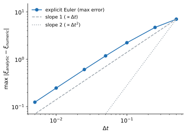
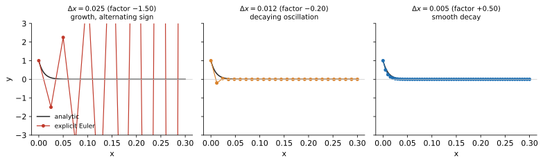
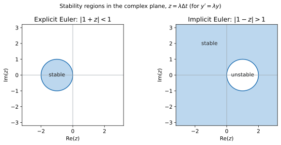

# Euler Error, Taylor Series and Stability

:::{admonition} Learning objectives
:class: tip
After this lesson you should be able to:

- explain why Euler's method is first-order accurate using the Taylor series
- derive the stability limit of explicit Euler for $y'=-\lambda y$ and show implicit Euler is unconditionally stable
- distinguish the step needed for stability from the step needed to avoid oscillation
:::

## Quantifying the error

Solving $d\xi/dt=-2t^3+12t^2-20t+8.5$ with $\xi(0)=1$ from $t=0$ to $5$ using explicit Euler, the numerical solution is compared with the analytic one

$$\xi(t)=1+8.5t-10t^2+4t^3-0.5t^4.$$

The error at each point is $\xi_{err}=\xi_{analytic}-\xi_{numeric}$, and a single global measure is the sum of squared errors, $\sum_i\xi_{err,i}^2$.

| $\Delta t$ | Sum of squared errors |
|---|---|
| 0.5 | about 106 |
| 0.1 | about 30 |

Reducing the step size improves the prediction, but not for free (more steps, more computation). Write the slope and the analytic solution as functions so that the step size can be changed easily and the comparison repeated.

**What controls the error?** At each step the predicted value differs from the true value because Euler follows a straight line (the slope at $t_i$) over the whole interval $\Delta t$. The error therefore depends on:

- the size of $\Delta t$, and
- the shape of the function (how much the slope changes over the step).

:::{admonition} Hands-on: Euler's method
:class: note
The error table above is computed in the same notebook as the Euler example. Work through **[Euler's method](../completed/01_Euler_Method.ipynb)** (the completed version, shown in this book), or [open the student version in Colab](<https://colab.research.google.com/github/kstrm/modeling-environmental-flows/blob/main/02-finite-differences-and-odes/notebooks/01_Euler_Method.ipynb>) and fill in the blanks yourself.
:::

## Taylor series

Any smooth function can be approximated as a polynomial. The value at $x_{i+1}$ can be predicted from the value and derivatives at $x_i$:

$$f(x_{i+1})=f(x_i)+f'(x_i)\,\Delta x+\frac{f''(x_i)}{2!}\Delta x^2+\frac{f'''(x_i)}{3!}\Delta x^3+\cdots+\frac{f^{(n)}(x_i)}{n!}\Delta x^n+\cdots,$$

with $\Delta x=x_{i+1}-x_i$. Keeping more terms gives successively better predictions:

- zeroth order: $f(x_{i+1})\approx f(x_i)$
- first order: $f(x_{i+1})\approx f(x_i)+f'(x_i)\Delta x$
- second order: adds $\frac{f''(x_i)}{2!}\Delta x^2$

For the ODE variable $\xi(t)$:

$$\xi_{i+1}=\xi_i+\Delta t\,\dot\xi_i+\frac{\Delta t^2}{2!}\ddot\xi_i+\frac{\Delta t^3}{3!}\xi^{(3)}_i+\cdots$$

Euler's method, $\xi_{i+1}=\xi_i+\Delta t\ g(\xi_i,t_i)$ with $g=\dot\xi_i$, agrees with the Taylor series up to first order, so it is a **first-order accurate** scheme. Equivalently,

$$\dot\xi_i=\frac{\xi_{i+1}-\xi_i}{\Delta t}+O(\Delta t),$$

meaning the truncation error is of order $\Delta t$. Halving the step roughly halves the error.

*Figure: Maximum error of explicit Euler for the example above. On a log-log plot the points follow the slope-1 line, the signature of a first-order method. A second-order method would follow the steeper dotted line.*

## Stability

A **stable** scheme gets closer to the true solution as it marches; an **unstable** scheme diverges.

Consider the model problem

$$\frac{dy}{dx}=-\lambda y,\qquad y(0)=y_0,\quad\lambda>0,$$

whose analytic solution is $y=y_0e^{-\lambda x}$ (separate variables: $\ln y=-\lambda x+c_1$, with $c_1=\ln y_0$).

### Explicit Euler

$$y_{i+1}=y_i+\Delta x(-\lambda y_i)=(1-\lambda\Delta x)\,y_i.$$

The numerical solution decays to zero only if $|1-\lambda\Delta x|<1$, i.e.

$$0<\Delta x<\frac{2}{\lambda}.$$

At $\Delta x=2/\lambda$ the factor is $-1$, so the solution oscillates without decaying; for larger $\Delta x$ it grows. Additionally, for $\lambda\Delta x>1$ the factor $(1-\lambda\Delta x)$ is negative, so the solution **oscillates in sign** even while decaying. To remove the oscillation we need

$$\Delta x<\frac1\lambda.$$

**Example:** $y'=-100y$, $y(0)=1$, from $x=0$ to $0.3$. Here $\lambda=100$:

- $\Delta x<2/100=0.02$ is required for the solution to converge to zero.
- $\Delta x<1/100=0.01$ is required to remove oscillations.
- With $\Delta x=0.1$ the solution blows up (the factor is $1-10=-9$). Try $\Delta x=0.025$, $0.012$ and $0.005$ in the notebook and observe the transition from growth (factor $-1.5$), to decaying oscillation (factor $-0.2$), to smooth decay (factor $+0.5$). At exactly $\Delta x=0.01$ the factor is zero and the first step lands on zero.

*Figure: Explicit Euler for $y^\prime=-100y$. The amplification factor $1-\lambda\Delta x$ sets the behavior: magnitude above 1 grows with alternating sign, a negative factor inside $(-1,0)$ decays with oscillation, and a positive factor decays smoothly.*

:::{admonition} Hands-on: Euler method: stability
:class: note
Try the step sizes from the example (0.1, 0.025, 0.012, 0.005) and watch the transition from growth to smooth decay. Work through **[Euler method: stability](../completed/02_Euler_Method-Stability.ipynb)** (the completed version, shown in this book), or [open the student version in Colab](<https://colab.research.google.com/github/kstrm/modeling-environmental-flows/blob/main/02-finite-differences-and-odes/notebooks/02_Euler_Method-Stability.ipynb>) and fill in the blanks yourself.
:::

### Implicit Euler

$$y_{i+1}=y_i+\Delta x(-\lambda y_{i+1})\;\Rightarrow\;y_{i+1}(1+\lambda\Delta x)=y_i\;\Rightarrow\;y_{i+1}=\frac{1}{1+\lambda\Delta x}\,y_i.$$

For stability we need $\left|\dfrac{1}{1+\lambda\Delta x}\right|<1$, which holds for **every** $\Delta x>0$ when $\lambda>0$: the implicit scheme is unconditionally stable for this problem. Even with $\Delta x=0.1$ the solution decays smoothly (though inaccurately). In general, implicit methods are more stable than explicit ones, at the cost of solving an equation at each step.

*Figure: Stability regions in the complex plane of $z=\lambda\Delta t$. Explicit Euler is stable only inside the unit disk centered at $-1$; implicit Euler is stable everywhere outside the disk centered at $+1$, which includes the whole left half-plane. This is the picture behind the statement that implicit methods are more stable.*

## Check your understanding

**1.** Why is explicit Euler first-order accurate?

:::{dropdown} Answer
It agrees with the Taylor series only through the first-derivative term, so the truncation error is $O(\Delta t)$ and halving the step roughly halves the error.
:::

**2.** For $y'=-50y$, what step sizes make explicit Euler decay, and decay without sign changes?

:::{dropdown} Answer
The factor is $1-\lambda\Delta x$. Decay needs $|1-\lambda\Delta x|<1$, so $\Delta x<2/50=0.04$. No oscillation needs the factor to stay positive, so $\Delta x<1/50=0.02$.
:::

**3.** What happens for $\lambda=100$ and $\Delta x=0.1$?

:::{dropdown} Answer
The factor is $1-10=-9$, so the numerical solution grows by a factor of 9 each step and alternates in sign, even though the true solution decays.
:::

**4.** Why would we accept the extra work of an implicit method?

:::{dropdown} Answer
For this problem $y_{i+1}=y_i/(1+\lambda\Delta x)$ decays for every $\Delta x>0$, so it is unconditionally stable. The price is solving an equation for $y_{i+1}$ at every step.
:::

## Further reading

A more formal treatment of stability is in Aref and Balachandar (2018): Sections 2.2 to 2.3 (fixed points) and Section 3.2 (Euler schemes). Reading Chapter 2 through Section 2.3 is encouraged.
