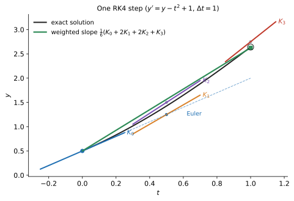

# Runge–Kutta Methods

:::{admonition} Learning objectives
:class: tip
After this lesson you should be able to:

- describe the idea of Runge–Kutta methods: intermediate slope evaluations within one step
- write the midpoint method and the classical RK4 step
- explain that RK methods are single-step and what their order means
:::

Runge–Kutta (RK) methods are higher-order, single-step schemes commonly used for ODEs. They were developed around 1900 by C. D. T. Runge, a German mathematician often called the father of numerical methods, and M. W. Kutta, an aerodynamicist.

## Central idea

Take multiple steps across a single step, using intermediate evaluations of the slope. For $dy/dt=g(y,t)$, a simple example is the **midpoint method**:

$$\tilde y=y_i+\tfrac12\Delta t\,g(y_i,t_i),\qquad y_{i+1}=y_i+\Delta t\,g\!\left(\tilde y,\,t_i+\tfrac12\Delta t\right).$$

The second line uses an approximation of the slope at the midpoint of the interval. Written in one line,

$$y_{i+1}=y_i+\Delta t\;g\!\left[y_i+\tfrac12\Delta t\,g(y_i,t_i),\;t_i+\tfrac12\Delta t\right].$$

This is a **second-order** RK method. (What does second order mean? The scheme agrees with the Taylor series through the $\Delta t^2$ term, so the local error is $O(\Delta t^3)$ and the global error is $O(\Delta t^2)$.)

## General form

$$y_{i+1}=y_i+\Delta t\,(\omega_0K_0+\omega_1K_1+\cdots+\omega_nK_n),$$

with

$$
\begin{aligned}
K_0&=g(y_i,t_i)\\
K_1&=g(y_i+\beta_{1,0}\Delta t\,K_0,\;t_i+\alpha_1\Delta t)\\
K_2&=g(y_i+\beta_{2,0}\Delta t\,K_0+\beta_{2,1}\Delta t\,K_1,\;t_i+\alpha_2\Delta t)\\
&\;\;\vdots\\
K_n&=g(y_i+\beta_{n,0}\Delta t\,K_0+\cdots+\beta_{n,n-1}\Delta t\,K_{n-1},\;t_i+\alpha_n\Delta t)
\end{aligned}
$$

(Eq. 3.3.15 of Aref and Balachandar, 2018.) The coefficients $\alpha$, $\beta$ and $\omega$ are chosen so that the scheme reproduces the Taylor series to the desired order of accuracy.

## The classical 4th-order method (RK4)

$$y_{i+1}=y_i+\frac{\Delta t}{6}\left(K_0+2K_1+2K_2+K_3\right)$$

with

$$
\begin{aligned}
K_0&=g(y_i,t_i)\\
K_1&=g\!\left(y_i+\tfrac{\Delta t}{2}K_0,\;t_i+\tfrac12\Delta t\right)\\
K_2&=g\!\left(y_i+\tfrac{\Delta t}{2}K_1,\;t_i+\tfrac12\Delta t\right)\\
K_3&=g\!\left(y_i+\Delta t\,K_2,\;t_i+\Delta t\right)
\end{aligned}
$$

RK4 needs information only at step $i$ to predict step $i+1$ to fourth-order accuracy.



*Figure: One RK4 step for $y^\prime=y-t^2+1$ with a deliberately large $\Delta t=1$. $K_0$ is the slope at the start, $K_1$ and $K_2$ are midpoint slopes using successive corrections, and $K_3$ is the slope at the end. Their weighted average (green) lands close to the exact value (circle), where a single Euler step (dashed) falls well short.*


## Building our own RK4

A toy model with a known solution:

$$\frac{dy}{dx}=\cos(x),\qquad y=\sin(x)+C_1,$$

where $f$ depends only on $x$ (not on $y$), which keeps it simple. Note that the independent variable is now $x$ rather than $t$.

```python
import numpy as np
import matplotlib.pyplot as plt

def f(x, y):
    return np.cos(x)

dx, start, end = 1.5, 0, 50
x = np.arange(start, end, dx)
y = np.zeros(len(x))
y[0] = np.cos(0)

for i in range(len(x) - 1):
    K1 = f(x[i],            y[i])
    K2 = f(x[i] + 0.5*dx,   y[i] + 0.5*dx*K1)
    K3 = f(x[i] + 0.5*dx,   y[i] + 0.5*dx*K2)
    K4 = f(x[i] + dx,       y[i] + dx*K3)
    y[i+1] = y[i] + (dx/6)*(K1 + 2*K2 + 2*K3 + K4)
```

The notebook then wraps the scheme in functions (`setup`, `RK4`) so the right-hand side and the domain can be swapped easily.

:::{admonition} Hands-on: 4th-order Runge–Kutta for one ODE
:class: note
Build RK4 yourself and compare it with Euler. Work through **[4th-order Runge–Kutta for one ODE](../completed/03_4th-Order_Runge-Kutta_InitialScheme_1ODE.ipynb)** (the completed version, shown in this book), or [open the student version in Colab](<https://colab.research.google.com/github/kstrm/modeling-environmental-flows/blob/main/02-finite-differences-and-odes/notebooks/03_4th-Order_Runge-Kutta_InitialScheme_1ODE.ipynb>) and fill in the blanks yourself.
:::

## Multistep methods

Another classic family of ODE methods, which we will also use for PDEs, is the multistep methods, e.g. the Adams–Bashforth–Moulton method. Read up on it and be prepared to (1) teach the class about the Adams–Bashforth method and (2) compare it to Runge–Kutta.

## Check your understanding

**1.** What does the midpoint method do differently from Euler?

:::{dropdown} Answer
It uses an Euler half-step to estimate the value at the middle of the interval, then evaluates the slope there and uses it across the whole step. This gives a second-order method.
:::

**2.** How many slope evaluations does one RK4 step need, and how are they combined?

:::{dropdown} Answer
Four ($K_0$ to $K_3$), combined as $y_{i+1}=y_i+\frac{\Delta t}{6}(K_0+2K_1+2K_2+K_3)$.
:::

**3.** Does RK4 need values from earlier steps?

:::{dropdown} Answer
No. It is a single-step method: it needs only step $i$, with the extra evaluations done inside the step.
:::

**4.** If you halve the step, roughly how does the global error change for a second-order and a fourth-order method?

:::{dropdown} Answer
It falls by about $2^2=4$ for second order and $2^4=16$ for fourth order. Euler (first order) falls only by about 2.
:::
