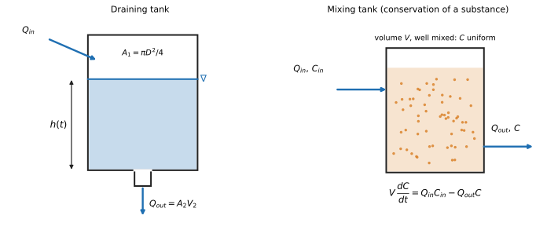

# Example: Draining a Tank

:::{admonition} Learning objectives
:class: tip
After this lesson you should be able to:

- derive the draining-tank ODE from conservation of mass
- use Bernoulli's equation as a closure for the exit velocity
- check a numerical solution against the analytic drain time
:::

A tank of diameter $D$ has a drain of diameter $d$ at the bottom. We want the water depth $h=h(t)$ and the time to drain. This is an **unsteady** problem, different from the typical steady problems in an undergraduate course.

*Figure: A draining tank (left) and a well-mixed tank carrying a dissolved substance (right).*

## Governing equation

Conservation of mass for the water in the tank, $dM/dt=\sum\dot m_{in}-\sum\dot m_{out}$, with $M=\rho\mathcal V$ and $\dot m=\rho Q$ ($Q$ is the volumetric flow rate):

$$\frac{d}{dt}(\rho A_1h)=\rho Q_{in}-\rho A_2V_2.$$

Since $A_1$ and $\rho$ do not depend on time,

$$\frac{dh}{dt}=\frac1{A_1}\left(Q_{in}-A_2V_2\right).$$

Note that $V_2=f(h)$ and $h=h(t)$, so we need a relationship between the exit velocity and the depth.

## Closure

Apply the energy (Bernoulli) equation from the free surface (1) to the drain exit (2), with $p_1=p_2=0$ (atmospheric), negligible head loss $h_L\approx0$ and $V_1\ll V_2$:

$$\frac{V_2^2}{2g}=z_1-z_2=h\;\Rightarrow\;V_2=\sqrt{2gh}.$$

This is a *closure model*: it supplies the missing relationship. With $A_1=\pi D^2/4$ and $A_2=\pi d^2/4$,

$$\boxed{\frac{dh}{dt}=\frac{4}{\pi D^2}\left(Q_{in}-\frac{\pi d^2}{4}\sqrt{2gh}\right)}$$

Can we solve it? And how will we know whether we implemented the numerical method correctly?

## Analytic solution for pure draining ($Q_{in}=0$)

$$\frac{dh}{dt}=-\frac{d^2}{D^2}\sqrt{2gh}\;\Rightarrow\;\int h^{-1/2}\,dh=-\frac{d^2}{D^2}\sqrt{2g}\int dt,$$

$$2h^{1/2}=-\frac{d^2}{D^2}\sqrt{2g}\,t+C_1\;\Rightarrow\;h^{1/2}=-\frac{d^2}{D^2}\sqrt{\frac g2}\,t+C_2.$$

With the initial condition $h=h_0$ at $t=0$, $C_2=h_0^{1/2}$:

$$h(t)=\left[h_0^{1/2}-\frac{d^2}{D^2}\sqrt{\frac g2}\;t\right]^2.$$

Setting $h=0$ gives the drain time,

$$t_{drain}=\frac{D^2}{d^2}\sqrt{\frac{2h_0}{g}}.$$

## Numerical solution

The equation has the form $dh/dt=g(h)$ with $g(h)=-\dfrac{d^2}{D^2}\sqrt{2gh}$. Solve it with 4th-order Runge–Kutta (see the [Runge–Kutta note](../../02-finite-differences-and-odes/notes/03-runge-kutta-methods.md)) and compare with the analytic solution above, which provides the check on the implementation.

:::{admonition} Hands-on: Draining tank with RK4
:class: note
Solve the tank equation with RK4 and compare it with the analytic solution. Work through **[Draining tank with RK4](../completed/04_4th-Order_Runge-Kutta_TankExample.ipynb)** (the completed version, shown in this book), or [open the student version in Colab](<https://colab.research.google.com/github/kstrm/modeling-environmental-flows/blob/main/03-ode-applications/notebooks/04_4th-Order_Runge-Kutta_TankExample.ipynb>) and fill in the blanks yourself.
:::

## A note on the end of the run

With $D=3$, $d=1/12$, $h_0=3$ (consistent units, e.g. ft) and $\Delta t=60$ s, the analytic drain time is about 9.3 min. If the run is carried past that time, the numerical solution produces `nan` and a `RuntimeWarning: invalid value encountered in sqrt`, because $h$ becomes slightly negative and $\sqrt{2gh}$ is undefined. (The analytic expression, being a square, would climb back up, which is unphysical.) The fix is to stop the loop once the depth is effectively zero, e.g. `if y[i+1] <= 0.001*y0: break`, and report the time at which that happened.

## Check your understanding

**1.** Why is a closure needed in the tank equation, and what is used?

:::{dropdown} Answer
The mass balance contains the exit velocity, which depends on the depth, $V_2=f(h)$. Bernoulli's equation from the free surface to the drain, with negligible losses and $V_1\ll V_2$, gives $V_2=\sqrt{2gh}$.
:::

**2.** Find the drain time for $D=3$, $d=1/12$, $h_0=3$ (ft), with $g=32.2$ ft/s$^2$.

:::{dropdown} Answer
$t_{drain}=\dfrac{D^2}{d^2}\sqrt{\dfrac{2h_0}{g}}=1296\sqrt{6/32.2}\approx560$ s, about 9.3 minutes.
:::

**3.** Why does a run that continues past the drain time produce `nan`?

:::{dropdown} Answer
The depth becomes slightly negative, so $\sqrt{2gh}$ is undefined and NumPy returns `nan` with a warning.
:::

**4.** How do you know the numerical implementation is correct?

:::{dropdown} Answer
For $Q_{in}=0$ there is an analytic solution, $h(t)=[h_0^{1/2}-(d^2/D^2)\sqrt{g/2}\,t]^2$, to compare against.
:::
