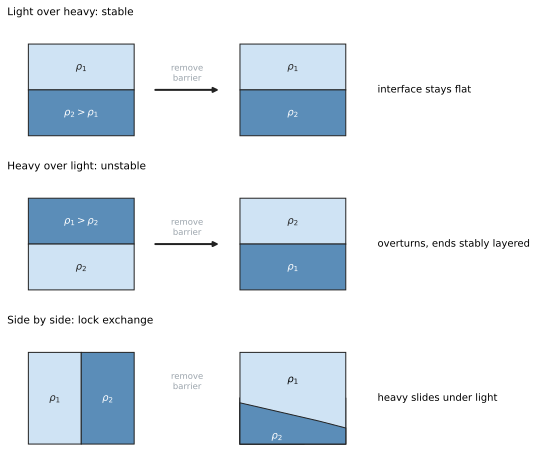
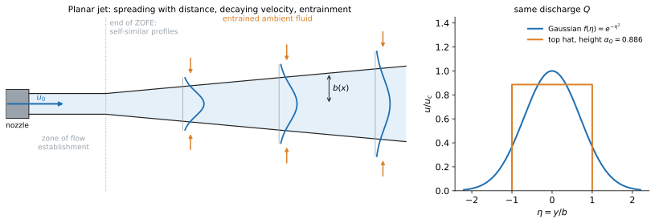

# Stratified Flows, Jets and Plumes: Introduction

:::{admonition} Learning objectives
:class: tip
After this lesson you should be able to:

- predict whether a stratified configuration is stable from the sign of $\partial\rho/\partial z$
- define reduced gravity and explain the Boussinesq approximation
- define the densimetric Froude number and the bulk Richardson number
:::

## What drives the dynamics?

Jets and plumes (for example, a discharge pipe in a lake or ocean, or a river entering a lake, reservoir or ocean) are driven by:

- differences in **momentum** (jets), and
- differences in **density** (plumes, density currents).

We need an introduction to density-driven flow before looking at equations to solve.

## Stratified fluids: stability

Consider two fluids separated by a barrier that is then removed. Let $z$ point up and gravity point down.

| Initial configuration | Behavior after the barrier is removed |
|---|---|
| Light fluid ($\rho_1$) above heavy fluid ($\rho_2$), $\rho_1<\rho_2$ | Stable; the interface stays flat. |
| Heavy fluid above light fluid, $\rho_1>\rho_2$ | Unstable; the interface overturns, and the fluids end up reversed, stably stratified. |
| Side by side, $\rho_1<\rho_2$ | The heavy fluid slides under the light fluid (lock exchange), ending stably layered. |
| Side by side, $\rho_1>\rho_2$ | Same exchange in the mirror-image direction. |

So:

$$\frac{\partial\rho}{\partial z}<0\Rightarrow\text{stable},\qquad\frac{\partial\rho}{\partial z}>0\Rightarrow\text{unstable},$$

and horizontal density gradients $\partial\rho/\partial x$ of either sign cause motion.

*Figure: Stability of two-fluid configurations after the barrier is removed. Dark blue is the denser fluid.*

**Where are $\partial\rho/\partial z$ and $\partial\rho/\partial x$ important?**

1. River discharge to a lake, reservoir or ocean: a buoyant surface layer with a vertical gradient and a horizontal gradient at the plume front.
2. A density current flowing along the bottom, with a vertical gradient at its upper interface and a horizontal gradient at its head.
3. Subaqueous jet and plume: a jet near the source becoming a rising plume.
4. Subaerial jet and plume (a smokestack): a jet near the source becoming a buoyant plume.

## Buoyancy and reduced gravity

Consider saltwater over freshwater versus saltwater over air. In which does the saltwater fall faster ($V_1$ versus $V_2$)? Think about the buoyancy force on an object of volume $\mathcal V_{obj}$ in a fluid of density $\rho_a$:

$$F_B=\rho_ag\,\mathcal V_{obj},$$

so the submerged (reduced) weight is

$$F_{sub}=F_W-F_B=(\rho_{obj}-\rho_a)\,g\,\mathcal V_{obj}.$$

The denser the surrounding fluid, the less the object appears to weigh.

**Two-layer system.** For a layer of fluid 2 (density $\rho_2$), depth $h$, width $w$ and length $L$ on a slope $\alpha$ beneath fluid 1 (density $\rho_1$), the gravitational driving force is

$$F_D=m_{sub}\,g_x=(\rho_2-\rho_1)(hwL)\,g\sin\alpha.$$

- (I) Water under air ($\rho_1=1.2$, $\rho_2=1000$ kg/m³): $\rho_2-\rho_1\approx\rho_{water}$, so $F_D\approx\rho_{water}g(hwL)\sin\alpha$.
- (II) $\rho_1=\rho_2$: $F_D=0$, so there is no driving force.
- (III) Seawater under freshwater ($\rho_1=1000$, $\rho_2=1025$ kg/m³): $F_D=(25\ \mathrm{kg/m^3})\,g\,(hwL)\sin\alpha$.

The ratio of driving forces, salt/fresh versus fresh/air, is $25/1000=0.025$, about 2.5 %. So the saltwater-over-air case ($V_2$) is much faster than saltwater over freshwater ($V_1$).

Another way to say it is that gravity is only about 2.5 % of what it was. Define the **reduced gravity**

$$(\rho-\rho_a)\,g=\rho\,g',\qquad g'=\frac{\rho-\rho_a}{\rho}\,g.$$

In most cases we can simply replace $g$ with $g'$ in the governing equations. This is the **Boussinesq approximation**.

## Dimensionless numbers

- In rivers, $Fr=u/c$ with wave celerity $c=\sqrt{gh}$.
- In stratified flows, the **densimetric Froude number** is $Fr_d=u/c_{interface}=u/\sqrt{g'h}$.
- The **bulk Richardson number** is the ratio of buoyancy to inertia:

  $$Ri=\frac1{Fr_d^2}=\frac{g'h}{u^2}.$$

## Interface stability and mixing

- If $\rho_2\gg\rho_1$, the buoyant force restores a displaced interface; if $\rho_2\approx\rho_1$, mixing is easier. High inertia, velocity and turbulence promote mixing.
- For a velocity profile $u(z)$ and density profile $\rho(z)$, the **gradient Richardson number** at the interface is

  $$Ri_g=\frac{-g\,\partial\rho/\partial z}{\rho_0\,(du/dz)^2}.$$

- $Ri_g>0.25$: low mixing, a sharper interface (subcritical flow).
- $Ri_g<0.25$: high mixing (supercritical flow); Kelvin–Helmholtz instabilities roll up and generate turbulence and mixing.

## Entrainment

Mixing pulls ambient fluid into the moving layer. Entrainment reduces the density difference $\Delta\rho$ and causes the discharge $Q$ and the layer thickness $h$ to increase with distance $x$. The entrainment flux is $E=w_e\rho_a$ with entrainment velocity

$$w_e=\delta\,u,\qquad\delta=A_2\left(1+718\,Ri^{2.4}\right)^{-1/2},$$

where $u$ is the current velocity and $A_2$ is an empirical coefficient.

## A jet

Consider a jet issuing from a nozzle with exit velocity $u_0$ into ambient fluid. In general $u=u(x,r)$, $c=c(x,r)$ and $\rho=\rho(x,r)$. Beyond the zone of flow establishment (ZOFE), profiles are self-similar:

$$\frac{u}{u_c}=f(\eta),\qquad\eta=\frac rb,\qquad u=u_c(x)\,f(\eta),$$

where $u_c$ is the centerline velocity and $b$ is the jet half-width. For jets, $f(\eta)$ is Gaussian, $f(\eta)=e^{-\eta^2}$.

Use the profile to get integral properties. For a planar jet of depth $h$ and width $2b$,

$$Q=A\,u_{avg}=h\cdot2\int_0^\infty u_cf(\eta)\,dy=2hb\,\alpha_Qu_c,\qquad u_{avg}=\alpha_Qu_c,$$

with $\alpha_Q=\sqrt\pi/2\approx0.886$ for a Gaussian profile. A **top-hat profile** instead has $u_c=u=u_{avg}$ across the width $2b$.

*Figure: Left: a planar jet leaves the nozzle, spreads linearly with distance after the zone of flow establishment, and entrains ambient fluid, so the centerline velocity decays. Right: the Gaussian profile and the top-hat profile of height $\alpha_Q=\sqrt\pi/2$ over $|\eta|<1$ carry the same discharge.*

## Check your understanding

**1.** With $z$ pointing up, which sign of $\partial\rho/\partial z$ is stable?

:::{dropdown} Answer
$\partial\rho/\partial z<0$ (lighter fluid above heavier fluid) is stable. $\partial\rho/\partial z>0$ is unstable and overturns. Horizontal gradients $\partial\rho/\partial x$ of either sign cause motion.
:::

**2.** Define the reduced gravity.

:::{dropdown} Answer
$g'=\dfrac{\rho-\rho_a}{\rho}g$. In most cases $g$ in the governing equations can simply be replaced by $g'$ (the Boussinesq approximation).
:::

**3.** By what factor is the driving force on seawater ($1025$ kg/m$^3$) beneath fresh water smaller than for water beneath air?

:::{dropdown} Answer
The density differences are 25 and about 1000 kg/m$^3$, a ratio of about $0.025$, so the force is about 2.5 % as large.
:::

**4.** How are $Ri$ and $Fr_d$ related?

:::{dropdown} Answer
$Ri=g'h/u^2=1/Fr_d^2$, where $Fr_d=u/\sqrt{g'h}$.
:::
