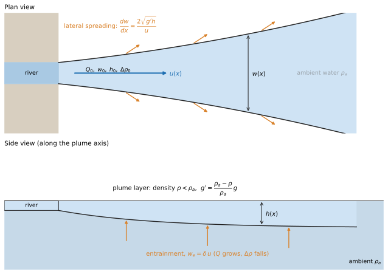

# River Mouth Plume Model

:::{admonition} Learning objectives
:class: tip
After this lesson you should be able to:

- list the five unknowns of the plume model and the equations that determine them
- explain why lateral spreading of a river plume needs its own closure
- describe the expected trends of $w$, $Q$, $u$, $\Delta\rho$ and $h$ with distance
:::

A steady, 1D (layer-averaged) model of a buoyant river plume entering a lake, reservoir or ocean, using top-hat profiles. The formulation follows Keyvani and Strom (2016), and the spreading closure follows Hetland and MacDonald (2008).

## Setup

- The discharge $Q_0$ leaves a river mouth of width $w_0$ and depth $h_0$ as a detached slot jet over ambient water of density $\rho_a$ (the plume has density $\rho<\rho_a$, $\Delta\rho=\rho_a-\rho$).
- Most slot-jet formulations are for $w/h=O(1)$. For rivers, $w/h\gg1$, so lateral spreading must be accounted for by a mechanism other than entrainment.
- We care only about the plume hydraulics: the plume widens ($w=w(x)$) and deepens ($h=h(x)$), entrains ambient water ($Q=Q(x)$), slows ($u=u(x)$) and dilutes ($\Delta\rho=\Delta\rho(x)$).

*Figure: Setup of the plume model. In plan view the plume widens, $w(x)$, at a rate set by the interfacial wave speed. In side view it deepens, $h(x)$, as ambient water is entrained through its base, which grows the discharge $Q(x)$ and dilutes the density difference $\Delta\rho(x)$.*

**Five unknowns** need five equations: $Q$, $u$, $w$, $h$, $\Delta\rho$. The definition $Q=hwu$ is one. Conservation principles supply the others: (1) fluid mass, (2) fluid volume, (3) fluid momentum, and (4) an ad hoc closure for the spreading rate. An entrainment law is still needed.

## Equations

**(1) Conservation of mass** (the buoyancy deficit $Q\Delta\rho$ is conserved):

$$\frac{d}{dx}(Q\,\Delta\rho)=0\;\Rightarrow\;\frac{d\Delta\rho}{dx}=-\frac{\Delta\rho}{Q}\frac{dQ}{dx}.$$

Using $Q=hwu$ this can be rearranged to give the depth change,

$$\frac{dh}{dx}=-h\left(\frac1{\Delta\rho}\frac{d\Delta\rho}{dx}+\frac1w\frac{dw}{dx}+\frac1u\frac{du}{dx}\right).\tag{A3}$$

**(2) Conservation of volume:** the plume gains volume only by entrainment through its base at the entrainment velocity $w_e$,

$$\frac{dQ}{dx}=w_ew\;\Rightarrow\;\frac{d\Delta\rho}{dx}=-\frac{\Delta\rho}{Q}w_ew=-\frac{\Delta\rho\,w_e}{uh}.\tag{A5}$$

**(3) Conservation of momentum:**

$$\frac{d}{dx}\left(u^2hw\right)=-\frac{d}{dx}\left(g'\frac{h^2}{2}w\right)+g'\frac{h^2}{2}\frac{dw}{dx},$$

with the change in momentum on the left and hydrostatic forces on the right. With $Ri=g'h/u^2$ this can be written

$$\frac{du}{dx}=\frac{u}{1-Ri}\left[\left(1+\frac{Ri}{2}\right)\frac1{\Delta\rho}\frac{d\Delta\rho}{dx}+Ri\,\frac1w\frac{dw}{dx}\right].\tag{A12}$$

**(4) Spreading rate:** Hetland and MacDonald (2008) observed that the lateral spreading rate at each edge goes as the interfacial wave speed $c_{interface}=\sqrt{g'h}$, with $g'=\dfrac{\rho_a-\rho}{\rho_a}g$. Then

$$\frac{dw}{dx}=2Ri^{1/2}=\frac{2\sqrt{g'h}}{u}.\tag{A13}$$

(Here $dx=u\,dt$, so the speed per unit time converts to a rate per unit distance.)

## Closure and solution

There are now four equations (A3, A5, A12, A13) for four primary unknowns, $u(x)$, $h(x)$, $w(x)$ and $\Delta\rho(x)$. We still need:

- initial conditions: $u_0$, $h_0$, $w_0$, $\Delta\rho_0$, and
- an entrainment law for $\delta=w_e/u$, such as the Richardson-number dependent form introduced in the [stratified flows note](04-stratified-flows-jets-and-plumes.md).

Typical solutions show $w$ and $Q$ increasing monotonically with distance, while $u$ and $\Delta\rho$ decrease and $h$ grows and levels off.

References: Keyvani and Strom (2016); Hetland and MacDonald (2008).

:::{admonition} Practice: Tar River backwater and a buoyant river plume
:class: important
Test yourself with the exercise **[Tar River backwater and a buoyant river plume](../exercises/tar-river-and-plume/index.md)**.
:::

## Check your understanding

**1.** What are the five unknowns, and what are the equations?

:::{dropdown} Answer
$Q$, $u$, $w$, $h$ and $\Delta\rho$. The definition $Q=hwu$ plus mass (buoyancy deficit), volume, momentum and a spreading-rate closure, with an entrainment law.
:::

**2.** Why can entrainment not explain the lateral spreading of a river plume?

:::{dropdown} Answer
Slot-jet formulations assume $w/h=O(1)$, but for rivers $w/h\gg1$. Hetland and MacDonald (2008) instead observed that each edge spreads at the interfacial wave speed, giving $dw/dx=2\sqrt{g'h}/u=2Ri^{1/2}$.
:::

**3.** Which quantity is conserved in the plume mass equation?

:::{dropdown} Answer
The buoyancy deficit $Q\,\Delta\rho$.
:::

**4.** How do the variables change downstream?

:::{dropdown} Answer
$w$ and $Q$ increase monotonically, $u$ and $\Delta\rho$ decrease, and $h$ grows and then levels off.
:::
