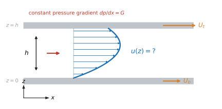

# Boundary Value ODEs: The Relaxation Method

:::{admonition} Learning objectives
:class: tip
After this lesson you should be able to:

- explain why a boundary value problem is solved all at once rather than by marching
- build the second-derivative matrix and impose boundary conditions in its first and last rows
- solve the resulting linear system with `linalg.solve` instead of forming an inverse
- interpret the Poiseuille–Couette solution as the pressure gradient varies
:::

Reference: Chapter 5 of Aref and Balachandar (2018).

Companion notebooks: [Linear system example](../completed/10_LinearSystemExample.ipynb) and [Poiseuille–Couette flow](../completed/11_BCproblem_Poiseuille-Couette.ipynb).

## Overview

- **Initial value problem:** an initial condition (IC) at one end, and we keep marching.
- **Boundary value problem (BVP):** a boundary condition (BC) at each end, and the solution must satisfy **both**.

Two methods:

1. **Relaxation method:** write out the finite-difference form at every grid point and solve the resulting system of equations.
2. **Shooting method:** an iterative initial value method (see the [shooting note](02-shooting-method.md)).

Two classic laminar flow solutions illustrate them: Poiseuille–Couette flow between plates (relaxation) and the Blasius boundary layer (shooting).

## Idea

Write the FD form for each point in the domain, then solve the system of equations. A general linear second-order BVP is

$$\frac{d^2u}{dy^2}+p(y)\frac{du}{dy}+q(y)\,u+r(y)=0.$$

With derivative mapping matrices (see the [spatial discretization note](../../02-finite-differences-and-odes/notes/06-spatial-discretization.md)), $u'_j=[D_1]_{jk}u_k$ and $u''_j=[D_2]_{jk}u_k$, where $u_k$ is the velocity at grid point $k$. The equation becomes

$$[L]_{jk}\,u_k=-r_j,\qquad[L]=[D_2]+[P][D_1]+[Q][I],$$

where $[P]$ and $[Q]$ are diagonal matrices holding $p(y_j)$ and $q(y_j)$ and $[I]$ is the identity. If we know $-r$ and have $[L]$, we can invert $[L]$ and solve for $u_k$.

**Boundary conditions** are included by modifying $L$ and $r$: replace the first and last rows of $L$ with $-1$ on the diagonal and zeros elsewhere, and put the boundary values in $r$:

$$L^*=\begin{bmatrix}-1&0&0&\cdots\\&\text{rows }2\text{ to }N\text{ same as }L&\\\cdots&0&0&-1\end{bmatrix},\qquad -r^*=-\begin{bmatrix}u_{BC,\text{first}}\\\text{rows }2\text{ to }N\text{ same as }r\\u_{BC,\text{last}}\end{bmatrix}.$$

The discretized system for all grid points is then $[L^*]_{jk}u_k=-r^*_j$, and multiplying by $[L^*]^{-1}$ gives all the $u_k$.

## Review: solving a linear system

$$\begin{aligned}a+b&=35\\2a+4b&=94\end{aligned}\qquad A=\begin{bmatrix}1&1\\2&4\end{bmatrix},\;X=\begin{bmatrix}a\\b\end{bmatrix},\;B=\begin{bmatrix}35\\94\end{bmatrix},\qquad AX=B\;\Rightarrow\;X=A^{-1}B.$$

```python
import numpy as np
from scipy import linalg

A = np.array([[1, 1], [2, 4]])
B = np.array([35, 94])
X = linalg.solve(A, B)          # [23., 12.]
```

Prefer `solve` to forming the inverse explicitly. (NumPy also provides `np.linalg.solve`.) Use plain 2D `np.array` objects for matrices (not the legacy `np.matrix`), and write matrix products with `@`: on arrays, `*` multiplies element by element, so `np.linalg.inv(A) * B` does **not** give the solution while `np.linalg.inv(A) @ B` does.

## Example: Poiseuille–Couette flow



*Figure: Setup for the Poiseuille–Couette example: flow between plates at $z=0$ and $z=h$ driven by a pressure gradient and plate motion.*

Steady, laminar, 2D, linear flow between two parallel plates separated by a gap $h$. The bottom plate ($z=0$) moves at $U_b$ and the top plate ($z=h$) at $U_t$, with a constant pressure gradient $dp/dx=G$. From the Navier–Stokes equations and these assumptions,

$$0=-\frac{dp}{dx}+\frac{d}{dz}\left(\mu\frac{du}{dz}\right)\;\Rightarrow\;\frac{d^2u}{dz^2}-\frac G\mu=0,$$

which is in the general form with $p=q=0$ and $r=-G/\mu$. Boundary conditions: $u(0)=U_b$ and $u(h)=U_t$.

**Matrices.** Here $[L]=[D_2]$. Using the central difference $f''_j=(f_{j-1}-2f_j+f_{j+1})/\Delta z^2$ (a 3-point stencil, second-order accurate),

$$D_2=\frac1{\Delta z^2}\begin{bmatrix}-1&0&0&\cdots&0\\1&-2&1&\cdots&0\\0&1&-2&1&\cdots\\&&\ddots&&\\0&\cdots&0&1&-2&1\\0&\cdots&&0&-1\end{bmatrix}\quad(\text{first and last rows hold the BC}),$$

and the right-hand side is $[r^*]=[U_b,\;G/\mu,\ldots,G/\mu,\;U_t]$ with the sign convention of the solve below. Why does this impose the BCs? Row 1 gives $-u_1=-U_b$, i.e. $u_1=U_b$; the last row gives $u_{N+1}=U_t$.

```python
import numpy as np
from scipy import linalg

h, Ub, Ut = 1.0, 0.0, 1.0
N, P = 100, 3                          # N intervals, dimensionless pressure gradient
dz = h / N
z = np.linspace(0, h, N + 1)
mu = ...                               # dynamic viscosity (from temperature and salinity)

stencil = np.array([1, -2, 1])
D2 = np.zeros((N + 1, N + 1))
for i in range(1, N):                  # interior rows only
    D2[i, i-1:i+2] = stencil
D2 *= 1 / dz**2
D2[0, 0] = -1                          # boundary-condition rows
D2[N, N] = -1

G = -2 * mu * Ut * P / h**2
r = np.zeros(N + 1)
r[1:N] = -G / mu
r[0], r[N] = Ub, Ut
u = linalg.solve(D2, -r)
```

### Without loops

The loop that fills `D2` can be replaced by assembling the matrix from diagonals, and several pressure gradients can be solved in one call because `linalg.solve` accepts a matrix of right-hand sides, one column per case. The matrix is factored once and reused for every column.

```python
# D2 from diagonals (instead of the loop)
D2 = (np.diag(-2*np.ones(N + 1)) + np.diag(np.ones(N), -1) + np.diag(np.ones(N), 1)) / dz**2
D2[0, :] = D2[N, :] = 0                # clear boundary rows ...
D2[0, 0] = D2[N, N] = -1               # ... and impose the boundary conditions

# all P values at once
P_values = np.array([-3, -2, -1, 0, 1, 2, 3])
G = -2 * mu * Ut * P_values / h**2
R = np.zeros((N + 1, len(P_values)))   # one column per case
R[1:N, :] = -G / mu
R[0, :], R[N, :] = Ub, Ut
U = linalg.solve(D2, -R)               # column k is the profile for P_values[k]
```

The results are identical to the loop version. Writing the loop version first makes it clear what each row of the matrix means; the vectorized version is what you would use once that is clear.

**Analytic solution** (for constant $\mu$ and $U_b=0$):

$$\frac{u}{U_t}=P\frac zh\left(1-\frac zh\right)+\frac zh,\qquad P=-\frac{Gh^2}{2\mu U_t}=\frac{h^2}{2\mu U_t}\left(-\frac{dp}{dx}\right).$$

The numerical and analytic profiles lie on top of each other. Varying $P$ from $-3$ to $3$ shows the transition from pure Couette flow ($P=0$, a linear profile) to flows with a favorable pressure gradient (velocity exceeding $U_t$ in the interior) and an adverse gradient (reversed flow near the bottom).

## Check your understanding

**1.** Why can't a boundary value problem be marched from one end like an initial value problem?

:::{dropdown} Answer
Conditions are given at both ends rather than only at the start, so all the grid values are coupled and are found together by solving a system of equations.
:::

**2.** How does the first row of the matrix impose $u(0)=U_b$?

:::{dropdown} Answer
The row is $-1$ on the diagonal with zeros elsewhere and the right-hand side holds $U_b$, so it reads $-u_1=-U_b$, i.e. $u_1=U_b$.
:::

**3.** What does an interior row of $D_2$ look like?

:::{dropdown} Answer
$[1,\,-2,\,1]/\Delta z^2$ centered on the diagonal.
:::

**4.** Why use `linalg.solve(A, B)` rather than `inv(A) @ B`?

:::{dropdown} Answer
It is faster and more accurate, and it is what we use for the larger systems that follow.
:::

**5.** How does the Poiseuille–Couette profile change with $P$?

:::{dropdown} Answer
$P=0$ gives pure Couette flow (a linear profile). A favorable pressure gradient makes the velocity exceed $U_t$ in the interior. An adverse gradient produces reversed flow near the bottom.
:::
