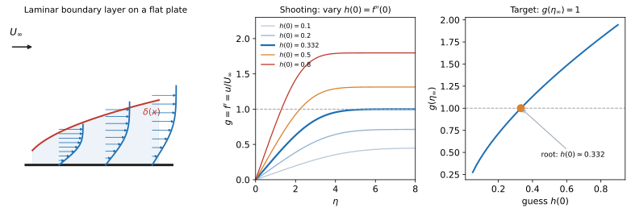

# The Shooting Method and the Blasius Boundary Layer

:::{admonition} Learning objectives
:class: tip
After this lesson you should be able to:

- explain why the Blasius problem is a boundary value problem
- convert it to three first-order ODEs and integrate with RK4
- iterate on the unknown initial value $h(0)$ with the secant method
- use the scaling symmetry to find $h(0)$ with a single extra shot
:::

Companion notebook: [Blasius boundary layer](../completed/12_BCproblem_Blasius.ipynb).

## Problem

For a laminar boundary layer over a flat plate, the velocity $u=u(x,z)$ approaches the free-stream value $U_\infty$ at the edge of the layer $\delta$. The governing equations are continuity and the boundary layer momentum equation:

$$\frac{\partial u}{\partial x}+\frac{\partial w}{\partial z}=0,\qquad u\frac{\partial u}{\partial x}+w\frac{\partial u}{\partial z}=\nu\frac{\partial^2u}{\partial z^2}.$$

These admit a **similarity solution**. With the similarity variable

$$\eta=\frac{z}{\sqrt{\nu x/U_\infty}},$$

all velocity profiles (at any $x$) can be expressed in terms of $\eta$, and the PDE collapses to the third-order, nonlinear ODE

$$f'''+\tfrac12ff''=0,\qquad f=f(\eta),\quad u=U_\infty f'(\eta).$$

(The notebook uses the equivalent $y$-based notation $\eta$, $f$, $g$, $h$.) The boundary conditions $u(x,0)=0$ and $u(x,\delta)=U_\infty$ become

$$f(0)=0,\qquad f'(0)=0,\qquad f'(\eta\to\infty)\to1.$$

## Decompose into first-order equations

Let $f'=g$ and $g'=h$ (so $h=f''$). Then $h'=f'''=-\tfrac12ff''=-\tfrac12fh$:

$$f'=g,\qquad g'=h,\qquad h'=-\tfrac12fh,$$

with initial conditions $f(0)=0$ and $g(0)=0$. The third condition is a far-field condition, $g(\eta\to\infty)\to1$, which is awkward to enforce, and there is no initial condition for $h(0)=f''(0)$. This is the difficulty of a boundary value problem.

## Shooting



*Figure: The boundary layer (left); trajectories for different guesses of $h(0)$ (center); the target function whose root is the correct initial slope (right).*

1. **Guess** a value for $h(0)$ (try $h(0)=1$ first).
2. Integrate the system as an initial value problem with RK4 out to a large $\eta$ (say 10).
3. **Check** whether $g(\eta_\infty)\to1$. If not, update $h(0)$ and repeat.

Define a difference function

$$\phi(h_0^k)=g_k(\eta_\infty;h_0^k)-1,$$

where $k$ is the iteration index. Given $h_0^k$ and $h_0^{k-1}$, a new guess comes from the secant method:

$$h_0^{k+1}=h_0^k+\Delta h_0,\qquad\Delta h_0=-\phi(h_0^k)\left[\frac{h_0^k-h_0^{k-1}}{\phi(h_0^k)-\phi(h_0^{k-1})}\right].$$

Keep updating until $\phi(h_0^k)\approx0$.

## Implementation

The right-hand side returns the three slopes, and the RK4 loop is the array version used for systems of ODEs:

```python
import numpy as np

def f(eta, y):                         # y = [f, g, h]
    return np.array([y[1], y[2], -0.5*y[0]*y[2]])

def blasius(eta, y, f0, g0, h0, delta):
    y[:, 0] = [f0, g0, h0]
    for i in range(len(eta) - 1):
        K1 = f(eta[i],             y[:, i])
        K2 = f(eta[i] + 0.5*delta, y[:, i] + 0.5*delta*K1)
        K3 = f(eta[i] + 0.5*delta, y[:, i] + 0.5*delta*K2)
        K4 = f(eta[i] + delta,     y[:, i] + delta*K3)
        y[:, i+1] = y[:, i] + (delta/6)*(K1 + 2*K2 + 2*K3 + K4)
    return y

def diff(h0, target=1.0):
    return blasius(eta, y, 0, 0, h0, delta)[1, -1] - target

h01, h02, tol = 0.0, 1.0, 1e-4
err = abs(diff(h02))
while err > tol:
    d1, d2 = diff(h01), diff(h02)
    dh = -d2 * (h02 - h01) / (d2 - d1)
    h01, h02 = h02, h02 + dh
    err = abs(diff(h02))
```

With the first guess $h(0)=1$, $g(\eta_\infty)\approx2.09$ rather than 1. The iteration converges to

$$f''(0)=h(0)\approx0.332,$$

the classic Blasius wall-shear value, and $g(\eta_\infty)=0.9999999\ldots$. The converged profile $u/U_\infty=f'(\eta)=g(\eta)$ rises smoothly from 0 at the wall to 1 by $\eta\approx5$.

## A shortcut: using the scaling symmetry

The Blasius equation $f'''+\tfrac12ff''=0$ has a scaling symmetry that removes the need to iterate. If $f(\eta)$ is a solution, so is

$$F(\eta)=\lambda f(\lambda\eta)\qquad\text{for any }\lambda>0.$$

To see this, differentiate: $F'=\lambda^2f'$, $F''=\lambda^3f''$ and $F'''=\lambda^4f'''$, while $FF''=\lambda^4ff''$, so every term of the equation picks up the same factor $\lambda^4$. The scaled solution still satisfies $F(0)=F'(0)=0$, but

$$F''(0)=\lambda^3\,f''(0),\qquad F'(\infty)=\lambda^2\,f'(\infty).$$

Now shoot once with any guess $h(0)=h_0$ and read off the far-field value $G=g(\eta_\infty)$. We want $F'(\infty)=\lambda^2G=1$, so $\lambda=G^{-1/2}$, and the correct initial slope is

$$h(0)=\lambda^3h_0=G^{-3/2}\,h_0.$$

With $h_0=1$ and $G\approx2.0854$ this gives $h(0)=G^{-3/2}\approx0.33206$, the converged value from the secant iteration, after a single extra integration. The shortcut works because the problem is homogeneous under the scaling. Most nonlinear BVPs have no such symmetry and need an iterative root-finder, so treat this as a special feature of similarity solutions.

## Check your understanding

**1.** Why is the Blasius equation a boundary value problem?

:::{dropdown} Answer
$f(0)=g(0)=0$ are known, but the third condition is a far-field condition, $g(\eta\to\infty)\to1$, and there is no initial value for $h(0)=f''(0)$.
:::

**2.** State the shooting steps.

:::{dropdown} Answer
Guess $h(0)$; integrate the ODEs as an initial value problem out to a large $\eta$; check whether $g(\eta_\infty)=1$; if not, update $h(0)$ (here with the secant method) and repeat.
:::

**3.** A shot with $h(0)=1$ gives $g(\eta_\infty)=2.0854$. What initial slope does the scaling shortcut give?

:::{dropdown} Answer
$h(0)=G^{-3/2}h_0=2.0854^{-3/2}\approx0.332$, the classic Blasius wall-shear value.
:::

**4.** How does shooting differ from the relaxation method?

:::{dropdown} Answer
Shooting turns the problem into an initial value problem and iterates on the missing initial condition. Relaxation discretizes the whole domain and solves one (linear) system with the boundary conditions built in.
:::
