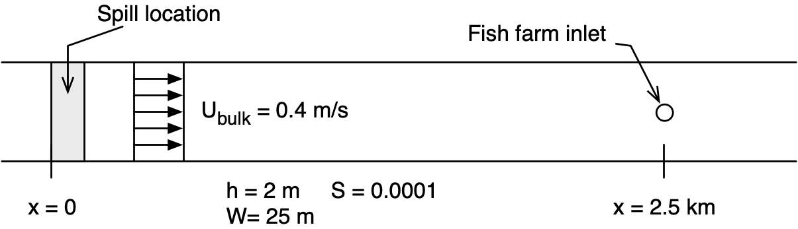

# Exercise: A Kerosene Spill

Related lessons: [PDE model equations](../../notes/01-pdes-classification-and-model-equations.md) and [the advection equation](../../notes/02-advection-equation-ftbs-ftcs.md).

**Starter notebook.** [Open `starter.ipynb`](<https://colab.research.google.com/github/kstrm/modeling-environmental-flows/blob/main/05-pdes/exercises/advection-diffusion-spill/starter.ipynb>) in Colab (or find it next to this page in the repository). The analytic solution and solver are left for you; the notebook provides parameters and plotting scaffolding. Try each problem before opening the hints at the bottom of this page.

A tanker truck has an accident and spills 100 kg of kerosene into a river (scenario adapted from Socolofsky and Jirka, 2004). The spill occurs over 3 minutes and can be treated as uniformly distributed across the river cross section. A fish farm has its water intake 2.5 km downstream of the spill.

If the river is well mixed across the section, kerosene transport follows the advection-diffusion equation

$$\frac{\partial C}{\partial t}+U\frac{\partial C}{\partial x}=D_L\frac{\partial^2C}{\partial x^2},$$

where $C$ is mass concentration ($\mathrm{kg/m^3}$). For an instantaneous volume source the analytic solution is

$$\frac{C}{C_o}=\frac12\left[\operatorname{erf}\!\left(\frac{x-Ut}{\sqrt{4D_Lt}}\right)-\operatorname{erf}\!\left(\frac{x-L-Ut}{\sqrt{4D_Lt}}\right)\right],$$

where $C_o$ is the initial concentration ($C=C_o$ for $0\le x\le L$ at $t=0$), $D_L$ is the longitudinal dispersion coefficient and $L$ is the initial length of the cloud. Take $L=U\ \Delta t_{spill}$ and $D_L=42\ \mathrm{m^2/s}$. (Choose a reasonable river velocity $U$ and cross-sectional area, and state them.)

1. Using the initial condition and the analytic solution, make two figures:
   1. $C$ vs $x$: the initial distribution and the distribution 2 hours after the accident. From the figure, find the location of the center of mass of the cloud, the maximum concentration in the river and the characteristic width of the cloud at $t=2$ h.
   2. $C$ vs $t$ at the fish farm intake. Will the concentration at the intake ever exceed $1\ \mu\mathrm{g/L}$?
2. Write a finite-difference solver for the 1D advection-diffusion equation using two discretization schemes of your choice. For each:
   - state the truncation error and the general stability conditions;
   - give the specific limits on $\Delta x$ and $\Delta t$ for this problem;
   - show empirically that the stability conditions must be met.
3. Compare the numerical and analytic solutions by plotting the numerical output on the two figures from problem 1. Show how the $t=2$ h solution changes with $\Delta x$. Which discretization is more accurate?
4. Upwind schemes produce numerical diffusion. How close to the analytic solution can you get by solving only the pure advection equation $\partial C/\partial t+U\ \partial C/\partial x=0$ with FTBS? What controls the amount of numerical diffusion?

## Hints

Try the problem first. Each hint is hidden until you open it, and the hints go from a gentle nudge to a stronger one.

**Problem 1 (analytic solution)**

:::{dropdown} Hint 1
The initial cloud length is $L=U\ \Delta t_{spill}$ and its concentration is $C_o=M/(AL)$, using your assumed $U$ and cross-sectional area $A$. Use `scipy.special.erf` for the solution.
:::

:::{dropdown} Hint 2
To find the center of mass and width at $t=2$ h, integrate numerically with `np.trapezoid(C, x)`: the center is $\int xC\ dx/\int C\ dx$. A cloud spreading by dispersion has $\sigma^2\approx2D_Lt$ (plus $L^2/12$ for the initial top-hat shape), which you can use to check your numbers.
:::

:::{dropdown} Hint 3
For the intake concentration, evaluate $C(x_{intake},t)$ for a range of times and find its maximum. Convert units before comparing: $1\ \mathrm{kg/m^3}=10^6\ \mu\mathrm{g/L}$.
:::

**Problem 2 (finite-difference solver)**

:::{dropdown} Hint 1
A natural pair of schemes: explicit upwind (FTBS) for advection with central differences for diffusion, and a second scheme such as Lax–Wendroff for advection. Update only the interior points `C[1:-1]` with slicing, as in the [advection lesson](../../notes/02-advection-equation-ftbs-ftcs.md).
:::

:::{dropdown} Hint 2
With $\nu=U\Delta t/\Delta x$ and $r=D_L\Delta t/\Delta x^2$, upwind advection with central diffusion is stable when $\nu+2r\le1$. The truncation error of the upwind advection term acts like an extra diffusion coefficient, $U\Delta x(1-\nu)/2$. Compare it with $D_L=42\ \mathrm{m^2/s}$ when choosing $\Delta x$.
:::

:::{dropdown} Hint 3
Make the domain long enough that the cloud does not reach the boundaries during 2 hours (the cloud moves about $U\times7200$ m). To show that the stability conditions matter, run with a time step slightly *above* the limit and watch the solution.
:::

**Problems 3 and 4**

:::{dropdown} Hint
Plot several $\Delta x$ values against the analytic curve at $t=2$ h and compare the errors, for example with the maximum concentration and the cloud width. For pure advection with FTBS, the numerical diffusion is $\tfrac{U\Delta x}{2}(1-\nu)$: what choices of $\Delta x$ and $\nu$ make it small or zero?
:::
