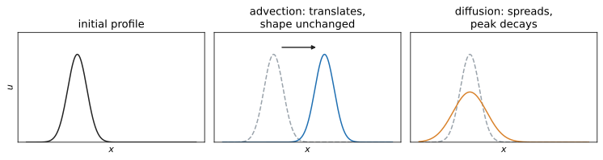

# PDEs: Terminology and Model Equations

:::{admonition} Learning objectives
:class: tip
After this lesson you should be able to:

- classify a PDE as scalar or system, linear or nonlinear, homogeneous or not, constant or variable coefficient
- identify the six model equations and what each isolates
- explain how advection and diffusion change a profile differently
:::

A partial differential equation (PDE) is an equation whose unknowns depend on more than one independent variable. The full governing equations for 1D, 2D and 3D flow are all PDEs.

- Solving for one unknown gives a **scalar PDE**; solving for several unknowns (e.g. $u,v$ or $Q,A$) gives a **system of PDEs**.
- **Linear:** all unknowns and their spatial and temporal derivatives appear only to the first power. For example, the 1D continuity equation $\partial A/\partial t+\partial Q/\partial x=0$ is linear, while the Saint-Venant momentum equation, with terms such as $\partial(Q^2/A)/\partial x$, is nonlinear.

Before looking at methods for the Navier–Stokes and Saint-Venant equations, we consider simple scalar PDEs that highlight different aspects of PDE solution.

## Terminology

For $u=u(x,t)$ ($u$ is the dependent variable or unknown; $x$ and $t$ are independent variables):

- **Homogeneous:** the dependent variable appears in all terms (no source term).
- **Constant coefficients:** the terms multiplying the unknown or its derivatives do not depend on the independent or dependent variables. **Variable coefficients:** the coefficients are functions of the independent variables.
- **Autonomous:** constant in time.

## Linear, homogeneous, scalar PDE

$$\frac{\partial u}{\partial t}=P\!\left(x,t,\frac{\partial}{\partial x}\right)u,\qquad P=\sum_{\ell=0}^{p}a_\ell(x,t)\frac{\partial^\ell}{\partial x^\ell},$$

a $p$th-order PDE with $P$ a polynomial in $\partial/\partial x$. (Be able to say why an equation is linear or nonlinear, homogeneous or not, constant- or variable-coefficient.)

## Six model equations

*Figure: Advection translates a profile without changing its shape; diffusion spreads it and lowers the peak.*

**1. Advection**, $P=-c\ \partial/\partial x$ with constant advective speed $c$:

$$\frac{\partial u}{\partial t}=-c\frac{\partial u}{\partial x}\qquad(1\text{ IC},\;1\text{ BC}).$$

Local change equals moving spatial change. If $u$ decreases in $x$ and the field moves right at speed $c$, then at a fixed point $u$ increases in time. Advection is a *conservative* process: it translates the profile but does not deform it.

**2. Diffusion**, $P=\nu\ \partial^2/\partial x^2$ with diffusion coefficient $\nu$:

$$\frac{\partial u}{\partial t}=\nu\frac{\partial^2u}{\partial x^2}\qquad(2\text{ BC},\;1\text{ IC}).$$

The local change is driven by the curvature of $u$ in space. Spatial gradients produce a diffusive flux $-\nu\ \partial u/\partial x$, and the local change is the spatial difference in that flux. Diffusion *dissipates* energy and momentum: a peak spreads and flattens in time.

**3. Advection–diffusion**, $P=-c\ \partial/\partial x+\nu\ \partial^2/\partial x^2$:

$$\frac{\partial u}{\partial t}=-c\frac{\partial u}{\partial x}+\nu\frac{\partial^2u}{\partial x^2},$$

with a conservative advective term and a dissipative diffusive term. A more complex version is used to track the movement of a substance in water.

**4. Burgers' equation:**

$$\frac{\partial u}{\partial t}=-u\frac{\partial u}{\partial x}+\nu\frac{\partial^2u}{\partial x^2}.$$

The difference from (3) is that the advecting speed is $u$ itself, making it **nonlinear**. It looks a little like a simplified Navier–Stokes equation.

**5. Wave equation:**

$$\frac{\partial^2u}{\partial t^2}=c^2\frac{\partial^2u}{\partial x^2}.$$

**6. Helmholtz / Poisson equation:**

$$\frac{\partial^2u}{\partial x^2}+\frac{\partial^2u}{\partial y^2}-\lambda u=g,$$

which is the Poisson equation for $\lambda=0$.

## Check your understanding

**1.** Why is Burgers' equation nonlinear while advection–diffusion is linear?

:::{dropdown} Answer
In Burgers' equation the advecting speed is $u$ itself, so the term $u\ \partial u/\partial x$ is not first power in the unknown. In advection–diffusion the speed $c$ is a constant.
:::

**2.** What does advection do to a profile, and what does diffusion do?

:::{dropdown} Answer
Advection translates the profile without changing its shape (conservative). Diffusion spreads it and lowers the peak (dissipative).
:::

**3.** How many initial and boundary conditions do the advection and diffusion equations need?

:::{dropdown} Answer
Advection: 1 initial condition and 1 boundary condition. Diffusion: 1 initial condition and 2 boundary conditions.
:::

**4.** Is the 1D continuity equation $\partial A/\partial t+\partial Q/\partial x=0$ linear?

:::{dropdown} Answer
Yes, the unknowns and their derivatives appear only to the first power. The Saint-Venant momentum equation is nonlinear.
:::
