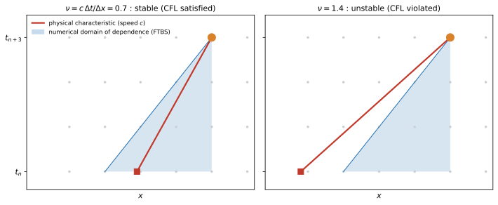

# Stability, the CFL Condition and von Neumann Analysis

:::{admonition} Learning objectives
:class: tip
After this lesson you should be able to:

- define consistency, stability and convergence
- compute the Courant number and apply the CFL condition
- carry out a von Neumann stability analysis for FTBS and FTCS
- explain numerical diffusion from the truncation error
:::

Companion notebook: [Stability and accuracy of schemes for advection and diffusion](../completed/14_AdvectionDiffusion_Schemes_Stability.ipynb).

The [previous note](02-advection-equation-ftbs-ftcs.md) showed that FTBS smears a square wave while FTCS blows up. Here we explain why, and give tools to decide beforehand whether a scheme will work.

## Three properties of a scheme

- **Consistency:** the truncation error goes to zero as $\Delta x,\Delta t\to0$ (the discrete equation approaches the PDE).
- **Stability:** errors (including round-off) do not grow without bound as the calculation marches forward.
- **Convergence:** the numerical solution approaches the true solution as the grid is refined.

For well-posed linear problems, the **Lax equivalence theorem** says that a consistent scheme converges if and only if it is stable. In practice, truncation error tells you the accuracy and stability analysis tells you the allowed step sizes.

## The Courant number and the CFL condition

*Figure: The CFL condition. When $\nu\le1$ the physical characteristic lies inside the numerical domain of dependence; when $\nu>1$ it falls outside and the scheme cannot be correct.*

For advection at speed $c$, define the Courant number

$$\nu=\frac{c\,\Delta t}{\Delta x},$$

the number of grid cells a wave travels in one time step. Information in the true solution moves at speed $c$. An explicit scheme at point $i$ uses only neighbors within a fixed number of cells, so if $\nu$ is too large the true cause of the solution at $(x_i,t_{n+1})$ lies outside the points the scheme uses. This is the **Courant–Friedrichs–Lewy (CFL) condition**: the numerical domain of dependence must contain the physical one. For the three-point explicit schemes here, it requires

$$|\nu|\le1.$$

The CFL condition is *necessary* for stability but not always *sufficient*: FTCS satisfies it for $\nu\le1$ and is still unstable.

## Truncation error and numerical diffusion

Expand FTBS, $\dfrac{u_i^{n+1}-u_i^n}{\Delta t}+c\dfrac{u_i^n-u_{i-1}^n}{\Delta x}=0$, with Taylor series about $(x_i,t_n)$:

$$u_t+c\,u_x=-\frac{\Delta t}{2}u_{tt}+\frac{c\,\Delta x}{2}u_{xx}+O(\Delta t^2,\Delta x^2).$$

Using $u_{tt}=c^2u_{xx}$ from the PDE, the scheme actually solves, to leading order, the **modified equation**

$$u_t+c\,u_x=\frac{c\,\Delta x}{2}(1-\nu)\,u_{xx}.$$

So FTBS adds an artificial diffusion with coefficient $\tfrac{c\Delta x}{2}(1-\nu)$. This is **numerical diffusion**. It is positive (and the scheme damps) for $\nu<1$, vanishes at $\nu=1$ (where FTBS is exact for pure advection) and is negative, so amplifying, for $\nu>1$. The smearing of the square wave you saw is this term, and it shrinks as $\Delta x\to0$.

## von Neumann stability analysis

For a linear constant-coefficient scheme, substitute a single Fourier mode

$$u_j^n=G^n\,e^{\mathrm{i}kx_j},\qquad\theta=k\,\Delta x,$$

where $G(\theta)$ is the **amplification factor**: how much that mode is multiplied by in one step. The scheme is stable if $|G(\theta)|\le1$ for all $\theta\in[0,\pi]$. The magnitude $|G|$ gives the damping of each wavelength and its argument gives the phase error.

**Example: FTBS.** Substituting gives

$$G=1-\nu\left(1-e^{-\mathrm{i}\theta}\right),\qquad|G|^2=1-2\nu(1-\nu)(1-\cos\theta).$$

Since $1-\cos\theta\ge0$, $|G|\le1$ for all $\theta$ if and only if $0\le\nu\le1$.

**Example: FTCS.** For $u_i^{n+1}=u_i^n-\tfrac\nu2(u_{i+1}^n-u_{i-1}^n)$,

$$G=1-\mathrm{i}\,\nu\sin\theta,\qquad|G|^2=1+\nu^2\sin^2\theta>1\ \text{for every }\theta\neq0,\pi.$$

FTCS is unstable for advection for any $\nu\neq0$. Decreasing $\Delta t$ does not help, only slows the growth per step.

**Example: diffusion with FTCS.** For $u_t=\nu_d\,u_{xx}$ and $u_i^{n+1}=u_i^n+r(u_{i+1}^n-2u_i^n+u_{i-1}^n)$ with $r=\nu_d\Delta t/\Delta x^2$,

$$G=1-4r\sin^2(\theta/2),$$

and $|G|\le1$ for all $\theta$ if and only if $r\le\tfrac12$. The time step must shrink with the *square* of the grid spacing, which makes explicit diffusion expensive on fine grids.

**Example: advection–diffusion with upwind advection and central diffusion.**

$$G=1-\nu\left(1-e^{-\mathrm{i}\theta}\right)-4r\sin^2(\theta/2).$$

Checking the worst case $\theta=\pi$ and the sign of the remaining terms shows the scheme is stable if and only if

$$\nu+2r\le1.$$

(This implies both $\nu\le1$ and $r\le\tfrac12$ but is stricter than either alone when both processes are present.)

## Summary of the schemes seen so far

| Scheme | Accuracy | Stability for $u_t+cu_x=0$ | Behavior |
|---|---|---|---|
| FTBS (upwind) | $O(\Delta t,\Delta x)$ | $0\le\nu\le1$ | smears fronts (numerical diffusion) |
| FTCS | $O(\Delta t,\Delta x^2)$ | unstable | grows oscillations |
| Lax | $O(\Delta x^2/\Delta t,\Delta t)$ | $\nu\le1$ | strong smearing, simple |
| Lax–Wendroff | $O(\Delta t^2,\Delta x^2)$ | $\nu\le1$ | accurate, oscillates at jumps |

The next note covers Lax, Lax–Wendroff, upwinding for variable direction, and implicit methods.

## Caveats

- von Neumann analysis assumes a **linear**, constant-coefficient problem on a periodic or infinite domain. Boundaries and nonlinearity (as in Burgers' or the Saint-Venant equations) can add restrictions, so in practice one uses it as a guide and verifies with numerical experiments.
- Stability does not mean accuracy: a stable scheme can still smear or distort the solution badly.

## Check your understanding

**1.** For $n_x=50$ points on $(0,2)$, $\Delta t=0.02$ and $c=1$, what is $\nu$ and is FTBS stable? What about $\Delta t=0.05$?

:::{dropdown} Answer
$\Delta x=2/49\approx0.0408$, so $\nu=0.49$ and FTBS is stable. With $\Delta t=0.05$, $\nu\approx1.2>1$ and it is unstable.
:::

**2.** State the CFL condition in words.

:::{dropdown} Answer
The numerical domain of dependence must include the physical one: information cannot travel more than one grid cell per time step, so $\nu=c\Delta t/\Delta x\le1$ for these schemes.
:::

**3.** Why is FTCS unstable for every $\nu$?

:::{dropdown} Answer
The amplification factor is $G=1-i\nu\sin\theta$, so $|G|^2=1+\nu^2\sin^2\theta>1$ for any $\nu\ne0$ and every Fourier mode that is not constant or alternating grows.
:::

**4.** What is the numerical diffusion of FTBS, and what happens at $\nu=1$?

:::{dropdown} Answer
The modified equation is $u_t+cu_x=\tfrac{c\Delta x}{2}(1-\nu)u_{xx}$, so smearing vanishes at $\nu=1$ and the scheme becomes exact for this problem.
:::

**5.** What is the stability limit for explicit diffusion?

:::{dropdown} Answer
$r=\nu_d\Delta t/\Delta x^2\le\tfrac12$.
:::
