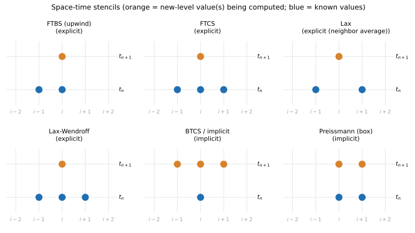

# Upwind, Lax and Implicit Schemes

Companion notebook: [Stability and accuracy of schemes for advection and diffusion](../completed/14_AdvectionDiffusion_Schemes_Stability.ipynb).

This note continues from [stability and the CFL condition](03-stability-cfl-and-von-neumann.md) with the main families of schemes used for advection, diffusion and their combination.

## Advection

### Upwinding

Information travels in the direction of the flow, so the spatial difference should use points *upstream*:

$$u_i^{n+1}=\begin{cases}u_i^n-\nu\,(u_i^n-u_{i-1}^n)&c>0\\u_i^n-\nu\,(u_{i+1}^n-u_i^n)&c<0\end{cases}$$

with $\nu=c\,\Delta t/\Delta x$. This is FTBS for $c>0$. It is stable for $|\nu|\le1$ and first-order accurate, and its numerical diffusion, $\tfrac{|c|\Delta x}{2}(1-|\nu|)$, is the price of the robustness. When the flow direction varies in space or time (tidal rivers, recirculation), the upwind direction must be chosen point by point.

### Lax (Lax–Friedrichs) method

Replace $u_i^n$ in FTCS by the average of its neighbors:

$$u_i^{n+1}=\tfrac12\left(u_{i+1}^n+u_{i-1}^n\right)-\frac\nu2\left(u_{i+1}^n-u_{i-1}^n\right).$$

This stabilizes FTCS for $|\nu|\le1$. Rewritten as FTCS plus a term, it adds numerical diffusion $\dfrac{\Delta x^2}{2\Delta t}(1-\nu^2)$, which is large for small time steps, so the Lax method smears fronts heavily. It is simple and robust, and it is the scheme in the 1D hydraulics lecture (see [1D unsteady hydraulics](../../06-1d-unsteady-hydraulics/notes/01-governing-equations-and-explicit-schemes.md)).

### Lax–Wendroff method

Use a Taylor series in time to second order, $u^{n+1}=u^n+\Delta t\,u_t+\tfrac{\Delta t^2}2u_{tt}$, and replace $u_t=-c\,u_x$ and $u_{tt}=c^2u_{xx}$:

$$u_i^{n+1}=u_i^n-\frac\nu2\left(u_{i+1}^n-u_{i-1}^n\right)+\frac{\nu^2}2\left(u_{i+1}^n-2u_i^n+u_{i-1}^n\right).$$

It is second order in both time and space and stable for $|\nu|\le1$. The added second-difference term supplies exactly enough diffusion to stabilize FTCS. It gives much sharper fronts than upwinding, but it oscillates (overshoots and undershoots) near discontinuities.

Vectorized in space, the interior update for the Lax and Lax–Wendroff schemes is, with `nu = c*dt/dx`:

```python
# Lax
u[1:-1] = 0.5*(un[2:] + un[:-2]) - 0.5*nu*(un[2:] - un[:-2])

# Lax-Wendroff
u[1:-1] = (un[1:-1] - 0.5*nu*(un[2:] - un[:-2])
           + 0.5*nu**2*(un[2:] - 2*un[1:-1] + un[:-2]))
```

### Accuracy versus monotonicity

Upwind gives a monotone, smeared solution; Lax–Wendroff gives a sharp solution with wiggles. **Godunov's theorem** says that no *linear* scheme of higher than first order can be monotone. Modern schemes such as TVD methods (total variation diminishing, with flux limiters) get around this by being *nonlinear*: they behave like Lax–Wendroff where the solution is smooth and like upwind near sharp fronts. The TVD step in the MacCormack scheme used for shock capturing in [1D unsteady hydraulics](../../06-1d-unsteady-hydraulics/notes/01-governing-equations-and-explicit-schemes.md) is of this type.

## Diffusion and advection–diffusion

Explicit FTCS for $u_t=\nu_d\,u_{xx}$ is stable only for $r=\nu_d\Delta t/\Delta x^2\le\tfrac12$. For advection–diffusion $u_t+c\,u_x=\nu_d\,u_{xx}$ with upwind advection and central diffusion, stability requires $\nu+2r\le1$.

**Cell Péclet number.** The ratio of advection to diffusion across one cell, $Pe_\Delta=|c|\Delta x/\nu_d$, controls accuracy. If it is large, central differencing of the advective term (FTCS-type) tends to produce wiggles and upwinding is preferred, but then the numerical diffusion $\tfrac{c\Delta x}{2}(1-\nu)$ can exceed the physical diffusion $\nu_d$. For a dispersion problem such as a spill, the grid spacing must be fine enough that the numerical diffusion is small compared with $D_L$.

## Implicit schemes

Explicit schemes compute each new value from known old values, which limits the time step (CFL for advection, $r\le\tfrac12$ for diffusion). **Implicit** schemes evaluate the spatial terms at the *new* time level, so every unknown at $t_{n+1}$ is coupled and a linear system must be solved each step. In return the time step is limited by accuracy, not stability.

**Backward-in-time, central-in-space (BTCS) for diffusion:**

$$-r\,u_{i-1}^{n+1}+(1+2r)\,u_i^{n+1}-r\,u_{i+1}^{n+1}=u_i^n.$$

This is a *tridiagonal* system, which is cheap to solve ($O(N)$ work). It is unconditionally stable ($|G|\le1$ for any $r$) and first-order in time. **Crank–Nicolson** averages the explicit and implicit spatial terms, giving second-order accuracy in time, and is also unconditionally stable for diffusion.

```python
import numpy as np
from scipy.linalg import solve_banded

nx, L = 101, 1.0
dx = L / (nx - 1)
x = np.linspace(0, L, nx)
nu_d, dt = 0.01, 0.01
r = nu_d * dt / dx**2                     # r = 1: far above the explicit limit of 0.5

u = np.exp(-((x - 0.5) / 0.05)**2)        # initial bump

# tridiagonal matrix in banded form; first and last rows hold u = 0 boundary conditions
ab = np.zeros((3, nx))
ab[0, 1:]  = -r
ab[1, :]   = 1 + 2 * r
ab[2, :-1] = -r
ab[1, 0] = ab[1, -1] = 1
ab[0, 1] = 0
ab[2, -2] = 0

for n in range(50):
    b = u.copy()
    b[0] = b[-1] = 0
    u = solve_banded((1, 1), ab, b)
```

Here $r=1$ and the solution remains stable and close to the exact Gaussian solution, while explicit FTCS would blow up at this step size.

**Implicit schemes for advection.** Backward-in-time upwind is unconditionally stable for $c>0$ but very diffusive at large $\nu$, and the central version is unconditionally stable with strong dispersion errors. Large time steps therefore buy stability but not accuracy: choose $\Delta t$ for the time scale of the physics you need to resolve.



*Figure: Stencils of the schemes in this module. Explicit schemes compute one new value from known ones; implicit schemes couple new-level values and require a linear solve.*

## Choosing a scheme

| Situation | Reasonable choice |
|---|---|
| Quick, robust advection | upwind (accept the smearing) |
| Smooth solutions, need accuracy | Lax–Wendroff or higher order |
| Sharp fronts or shocks | TVD / limited schemes (e.g. MacCormack with TVD) |
| Diffusion on fine grids | implicit (BTCS or Crank–Nicolson) |
| Rivers, long durations | implicit (e.g. Preissmann, see [1D unsteady hydraulics](../../06-1d-unsteady-hydraulics/notes/02-boundary-conditions-and-implicit-schemes.md)) |
