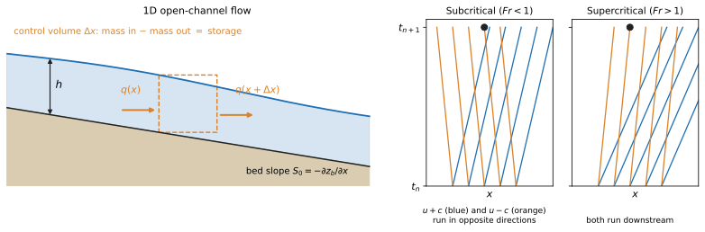
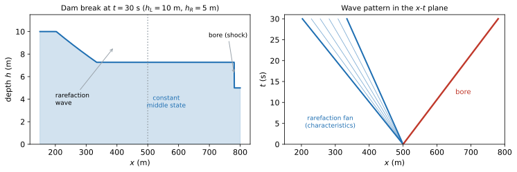

# The Saint-Venant Equations, Wave Speeds and the CFL Limit

:::{admonition} Learning objectives
:class: tip
After this lesson you should be able to:

- write the 1D Saint-Venant equations and state their assumptions
- compute the wave speeds $u\pm c$ and the Froude number
- state how many boundary conditions are needed for subcritical and supercritical flow
- compute the CFL limit for the explicit schemes
:::

Companion notebook: [Dam-break flow with the Lax and MacCormack schemes](../completed/15_DamBreak_Lax_MacCormack.ipynb).

The 1D equations for unsteady open-channel flow are the depth-and-cross-section-averaged mass and momentum equations introduced in [module 01](../../01-governing-equations/notes/01-components-of-a-model-and-governing-equations.md). Here we derive them, identify the waves they carry, and find the stability limit for the explicit schemes in the [next note](01-governing-equations-and-explicit-schemes.md).

## Assumptions

- Flow is one-dimensional: the velocity $u$ is uniform over each cross section and varies only in $x$ and $t$.
- The pressure is hydrostatic (vertical accelerations are negligible).
- The bed slope is small, so $\cos\theta\approx1$ and depth measured vertically is the depth perpendicular to the bed.
- Friction is represented by a steady-flow formula, e.g. Manning's equation.
- The fluid is incompressible and the channel is prismatic, or the width variations are given.

## Derivation for a rectangular channel

Take a control volume of length $\Delta x$ in a channel of width $B$, with depth $h(x,t)$, velocity $u(x,t)$ and discharge per unit width $q=hu$.

**Mass.** The rate of change of volume equals net inflow plus lateral inflow:

$$B\,\Delta x\,\frac{\partial h}{\partial t}=B\left[q(x)-q(x+\Delta x)\right]+q_l\,\Delta x\;\;\Rightarrow\;\;\frac{\partial h}{\partial t}+\frac{\partial q}{\partial x}=\frac{q_l}{B}.$$

For a general cross section, $\partial A/\partial t+\partial Q/\partial x=q_l$.

**Momentum.** The rate of change of momentum in the control volume equals the net momentum flux plus the forces:

$$\frac{\partial q}{\partial t}+\frac{\partial}{\partial x}\left(\frac{q^2}{h}+\frac12gh^2\right)=gh\,(S_0-S_f).$$

The terms are:

| Term | Meaning |
|---|---|
| $\partial q/\partial t$ | local acceleration |
| $\partial(q^2/h)/\partial x$ | convective acceleration (momentum flux) |
| $\partial(\tfrac12gh^2)/\partial x$ | net hydrostatic pressure force |
| $ghS_0$ | gravity component along the bed, $S_0=-\partial z_b/\partial x$ |
| $ghS_f$ | bed friction, e.g. Manning: $S_f=n^2u|u|/h^{4/3}$ (SI units) |

Together with the conservative form $\mathbf U_t+\mathbf F_x=\mathbf S$ with $\mathbf U=(h,hu)^T$ and $\mathbf F=(hu,\;hu^2+\tfrac12gh^2)^T$, these are the **Saint-Venant** (or shallow-water) equations. In terms of $(h,u)$ and for a frictionless, horizontal channel without lateral inflow,

$$h_t+u\,h_x+h\,u_x=0,\qquad u_t+u\,u_x+g\,h_x=0.$$

## Waves and characteristics

*Figure: Control volume for the 1D equations (left) and characteristic directions for subcritical and supercritical flow (right).*

Write the $(h,u)$ system as $\mathbf W_t+\mathbf A\,\mathbf W_x=\mathbf 0$, with

$$\mathbf W=\begin{pmatrix}h\\u\end{pmatrix},\qquad\mathbf A=\begin{pmatrix}u&h\\g&u\end{pmatrix}.$$

The eigenvalues of $\mathbf A$ are $u\pm c$ with the **wave celerity**

$$c=\sqrt{gh}$$

(for a general section, $c=\sqrt{gD}$ with hydraulic depth $D=A/B$). These are the speeds at which small disturbances travel relative to the bank: $u+c$ downstream and $u-c$ upstream. Along these **characteristic curves**,

$$\frac{d}{dt}\,(u\pm2c)=g\,(S_0-S_f)\qquad\text{on}\qquad\frac{dx}{dt}=u\pm c,$$

which is the basis of the method of characteristics used for boundary conditions (see [boundary conditions](02-boundary-conditions-and-implicit-schemes.md)). Without friction and slope, $u\pm2c$ are constant along the characteristics (the **Riemann invariants**).

The **Froude number** $Fr=|u|/c$ decides how the characteristics are oriented:

- **Subcritical** ($Fr<1$): $u+c>0$ and $u-c<0$, so information travels both upstream and downstream. One boundary condition is needed at each end of a reach.
- **Supercritical** ($Fr>1$): both speeds are positive, so disturbances cannot travel upstream and both boundary conditions are set at the upstream end.
- **Transcritical** flow passes through $Fr=1$, which is the case that motivates shock-capturing schemes.

*Figure: Exact dam-break solution for $h_L=10$ m and $h_R=5$ m: a rarefaction fan moves upstream and a bore moves downstream, separated by a constant middle state ($h_m\approx7.27$ m).*

## Which terms matter? Simplified wave models

Dropping terms from the momentum equation gives a hierarchy of models:

- **Kinematic wave:** only $S_0=S_f$ remains, so the flow is locally uniform and waves travel at a speed set by the friction law. It cannot represent backwater effects.
- **Diffusion wave:** keeps the pressure-gradient term but drops inertia, so $\partial h/\partial x$ (backwater) matters and the wave attenuates.
- **Dynamic wave:** the full Saint-Venant momentum equation.

Roughly speaking, the more rapidly the flow changes and the stronger the downstream control, the more of the full equations are needed.

## The CFL limit for the explicit schemes

For the Lax and MacCormack schemes of the [next note](01-governing-equations-and-explicit-schemes.md), the numerical domain of dependence must include the physical one (see [stability and the CFL condition](../../05-pdes/notes/03-stability-cfl-and-von-neumann.md)). The fastest wave moves at $|u|+c$, so

$$\Delta t\le\frac{\Delta x}{\max_i\left(|u_i|+c_i\right)}.$$

**Example.** A river 2 m deep flowing at 1 m/s has $c=\sqrt{9.81\times2}=4.43$ m/s, so $Fr=0.23$ and the wave speeds are $u+c=5.43$ and $u-c=-3.43$ m/s. On a grid with $\Delta x=100$ m, the time step is limited to $\Delta t\le100/5.43\approx18$ s, even though the water itself moves only 18 m in that time. Because $c$ depends on depth, the limit changes as the flood wave rises, so codes recompute $\Delta t$ every step.

Implicit schemes such as Preissmann's box scheme are not bound by this limit, which is why they are used for long simulations of rivers.

## Check your understanding

**1.** For $h=0.5$ m and $u=3$ m/s, what are $c$, $Fr$ and the wave speeds? Is the flow sub- or supercritical?

:::{dropdown} Answer
$c=\sqrt{9.81\times0.5}\approx2.21$ m/s, $Fr\approx1.35$, and $u\pm c\approx5.21$ and $0.79$ m/s. Both are positive, so the flow is supercritical.
:::

**2.** How many boundary conditions does each case need?

:::{dropdown} Answer
Subcritical flow needs one at each end of the reach. Supercritical flow needs both at the upstream end, because disturbances cannot travel upstream.
:::

**3.** For the flow above on a grid with $\Delta x=50$ m, what is the largest time step?

:::{dropdown} Answer
$\Delta t\le\Delta x/(|u|+c)=50/5.21\approx9.6$ s.
:::

**4.** Why is the time step set by $|u|+c$ rather than by $u$?

:::{dropdown} Answer
Disturbances travel at $u\pm c$, and the numerical domain of dependence must include the fastest of them.
:::
