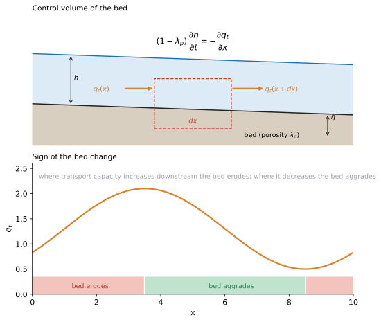

# Introduction to 1D Morphodynamics: The Exner Equation

:::{admonition} Learning objectives
:class: tip
After this lesson you should be able to:

- write the 1D Exner equation and explain each term
- relate the sign of $\partial q_t/\partial x$ to erosion and deposition
- list what closes the coupled hydraulics and morphodynamics system
- compare Meyer-Peter and Müller and Engelund–Hansen transport relations
:::

The Saint-Venant equations (mass and momentum) solve for the depth $h$ and velocity $u$ as functions of $x$ and $t$ over a *fixed* bed. **Morphodynamics** adds the change in the boundary, the bed, and the influence of that change back on the hydrodynamics. The two are coupled in a loop: hydraulics drive sediment transport, transport changes the bed, and the new bed alters the hydraulics.

## Conservation of bed sediment

Consider a short bed segment of length $dx$ with bed elevation $\eta(x,t)$, so the depth is $h$ and the water surface elevation is $\eta+h$. Sediment leaves the water column by deposition $D$ and enters it by erosion $E$. Applying conservation of sediment mass in the bed gives the **1D Exner equation**:

$$(1-\lambda_p)\frac{\partial\eta}{\partial t}=-\frac{\partial q_t}{\partial x},$$

where $\lambda_p$ is the porosity of the bed and $q_t=q_s+q_b$ is the total volumetric sediment flux per unit width, the sum of suspended load $q_s$ and bed load $q_b$. Where the transport capacity increases in the downstream direction ($\partial q_t/\partial x>0$) the bed erodes, and where it decreases the bed aggrades. With a width variation $w(x)$ the equation becomes the form used in the [MacCormack example](01-governing-equations-and-explicit-schemes.md), $\partial\eta/\partial t+\partial(q_s/(1-\lambda_p))/\partial x=-(1/w)(\partial w/\partial x)\ q_s/(1-\lambda_p)$.

*Figure: Top: conservation of bed sediment for a short segment of length $dx$. Bottom: where the transport rate $q_t$ increases downstream the bed erodes, and where it decreases the bed aggrades.*

## A closed set of equations

1D morphodynamics is then:

1. 1D continuity,
2. 1D momentum, and
3. the 1D Exner equation,

three equations for three unknowns, $h$, $u$ and $\eta$. To close it we need an expression for the transport rate $q_t$. A resistance relation is also needed to connect the hydraulics ($h$, $u$ and the slope $-\partial(\eta+h)/\partial x$) to the bed shear stress $\tau_B$ or shear velocity $u_*$ that drives the transport.

## Two common transport closures

Both are written in terms of the dimensionless bed shear stress (Shields stress) $\tau^*=\tau_B/(\rho g R_s d)$, with grain size $d$ and submerged specific gravity $R_s=(\rho_s-\rho)/\rho$.

**Meyer-Peter and Müller (MPM)**, bed load:

$$q_t=q_b=\sqrt{gR_sd^3}\;\alpha\,\left(\tau^*-\tau^*_{cr}\right)^{\beta},$$

with empirical coefficients $\alpha$, $\beta$ and the critical Shields stress $\tau^*_{cr}$. A common calibration is $\alpha=8$, $\beta=3/2$, $\tau^*_{cr}=0.047$ (as used in the contraction test case of the MacCormack example).

**Engelund–Hansen**, total load:

$$q_t=\sqrt{gR_sd^3}\;\frac{0.05}{C_f}\,\left(\tau^*\right)^{5/2},$$

where $C_f$ is a resistance (friction) coefficient.

Both increase rapidly with shear stress, so small changes in flow can produce large changes in transport, and the bed responds on a much longer time scale than the water. This difference in time scales is why many models solve the hydraulics, update the bed, and repeat (a *loose coupling*), and why long-term simulations use sequences of steady or quasi-unsteady flows rather than resolving every flood wave.

:::{admonition} Practice: Capstone project ideas
:class: important
Test yourself with the exercise **[Capstone project ideas](../exercises/capstone-projects/index.md)**.
:::

## Check your understanding

**1.** Write the Exner equation.

:::{dropdown} Answer
$(1-\lambda_p)\ \partial\eta/\partial t=-\partial q_t/\partial x$, with bed elevation $\eta$, bed porosity $\lambda_p$ and total volumetric sediment flux $q_t$ per unit width.
:::

**2.** Where the transport rate increases downstream, does the bed erode or aggrade?

:::{dropdown} Answer
It erodes ($\partial q_t/\partial x>0$ makes $\partial\eta/\partial t<0$). Where transport decreases downstream, sediment deposits.
:::

**3.** The system has three equations for $h$, $u$ and $\eta$. What else is needed?

:::{dropdown} Answer
A transport closure for $q_t$ and a resistance relation linking the hydraulics to the bed shear stress.
:::

**4.** Why are hydraulics and bed change often solved in alternation (loose coupling)?

:::{dropdown} Answer
The bed responds on a much longer time scale than the water.
:::

**5.** How do MPM and Engelund–Hansen differ?

:::{dropdown} Answer
MPM is a bed-load relation with $(\tau^*-\tau^*_{cr})^{3/2}$; Engelund–Hansen is a total-load relation proportional to $(\tau^*)^{5/2}/C_f$.
:::

## What to read next

- Parker, G., *1D Morphodynamics of Rivers and Turbidity Currents* (free e-book, listed in the [references](../../references.md)).
- The capstone project ideas in this module's [exercises](../exercises/capstone-projects/index.md), which ask what the bed does in the Tar River scenarios and below a dam.
